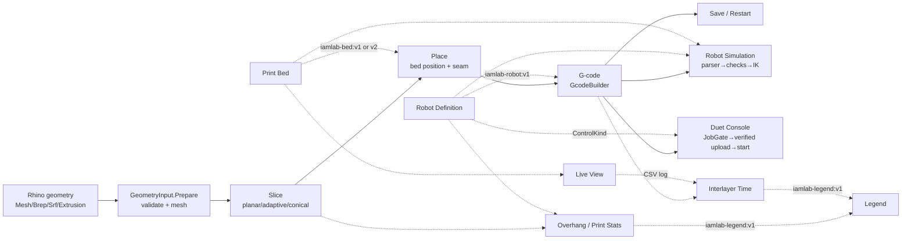
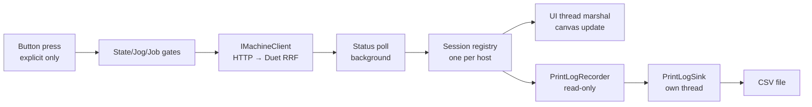
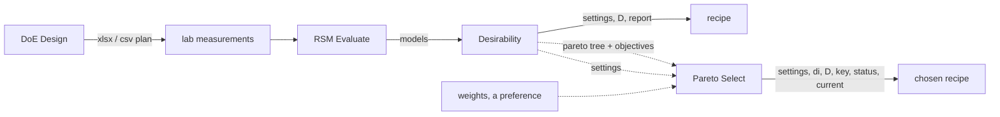

# Lugworm Architecture Documentation

## 1. How to Read This Document

This document is the architectural ground truth for the **Lugworm** repository. It is written for developers (human or AI) planning, implementing, or reviewing changes.

- Sections 2-7 cover the universals: what the project is, its stack, structure, and build.
- Sections 8-18 cover the domain subsystems, ordered along the user's workflow: components, slicing, G-code, robots, machine control, calibration, packaging.
- Sections 19-24 cover cross-cutting concerns: data flow, errors, testing, performance, deployment.

**Precedence rule:** where prose elsewhere in the repo disagrees with source and project files, the source wins. Prose docs can lag behind releases (version pins, ribbon-group counts, test counts) - trust the source and the changelog over any narrative document.

## 2. Overview

Lugworm is a **Rhino 8 (Windows) / Grasshopper plugin** for clay / LDM (liquid deposition modeling) 3D printing, developed at IDAC@TUHH. Thermoplastic (FDM) printing was added in 4.0.0 and removed again in 4.1.0 (LDM-only). It covers the full workflow from geometry to a running print:

- **Slicing** - planar, adaptive, and conical (non-planar) layer generation with walls, infill, spiral, and Fermat paths
- **Placement** - positioning on the print bed with six seam-control strategies
- **G-code generation** - Marlin / Duet RepRapFirmware / Klipper dialects, ram and pump extrusion models, retraction, arcs (built-in fitter or external ArcWelder), restart planning
- **Robot simulation & validation** - one **Robot Definition** selects the machine; SCARA print arm (3DPotter Potterbot Scara v4), generic Cartesian, or none. Kinematics and safety checks follow that selection (§12.1)
- **Direct machine control** - Duet WiFi (RRF) HTTP control behind one transport seam: status, jog, terminal, file management, verified upload, print start
- **Analysis & legends** - overhang, print statistics, interlayer timelines, and a configurable **Legend** that renders the scale those analyses emit
- **DoE calibration** - designed-experiment print-parameter calibration (DSD/BBD/Taguchi/full-factorial to RSM/ANOVA to desirability optimization)

**Architecture in one sentence:** a Rhino-independent computation library (`Lugworm.Core`) behind a Grasshopper adapter shell (`Lugworm`), tested by an xUnit project (`Lugworm.Core.Tests`).

**Project classification:** hybrid - primary product is a desktop **host plugin** (deployable `.gha` inside Rhino/Grasshopper); secondary aspect is a reusable **library** (Core has no Rhino dependency).

## 3. Technology Stack

| Area | Stack |
|---|---|
| Language | C# (`LangVersion=latest`, nullable enabled) |
| Plugin TFMs | `net7.0-windows`, `net7.0`, `net48` (Rhino 8 loads netcore or netfx) |
| Core TFMs | `net7.0`, `net48` |
| Tests TFMs | Full Core suite: `net10.0`; focused shared-assertion suite: `net48`, `net7.0`, `net7.0-windows` |
| Host SDK | Grasshopper `8.0.23304.9001` (RhinoCommon arrives transitively), `ExcludeAssets="runtime"` - Rhino supplies these at runtime |
| Geometry/paths | Clipper2 `1.4.0`, built from vendored upstream sources (`third_party/Clipper2`, exact-source deterministic rebuild with identical assembly identity; the NuGet binary embeds its author's local path - see `PROVENANCE.md` there) |
| Numerics | MathNet.Numerics `5.0.0` (SCARA least-squares calibration, RSM statistics) |
| UI | Grasshopper canvas + WinForms, `System.Drawing`; the Duet Console window is drawn with SkiaSharp |
| Console rendering | SkiaSharp `2.88.6` (+ `Views.WindowsForms`, `Views.Desktop.Common`, `NativeAssets.Win32`) and OpenTK `3.1.0`, all MIT. **Exact-pinned, never floated**: Rhino ships no SkiaSharp but other plugins do, and every 2.88.x build shares managed identity `2.88.0.0`, so the first plugin loaded wins for all of them; matching the version already in the ecosystem keeps that benign in either order |
| Tests | xUnit `2.6.2`, Microsoft.NET.Test.Sdk `17.8.0` |
| Packaging | `tools/release.ps1` allowlisted candidate/public ZIP pipeline; Yak is public-mode or explicit opt-in only |

Deliberately dependency-free implementations in Core: XLSX read/write (raw ZIP+XML in `Doe/`), JSON parsing (Duet, RSM models, settings files), Duet HTTP (BCL `HttpClient`). Python appears only in utility/asset scripts, not at runtime.

**Reproducibility caveats:** no `global.json` (C# `latest` floats with the installed SDK); no lockfiles; supported product claim is Rhino 8 on Windows only - do not infer Rhino 7 / macOS support from the TFM list.

## 4. Project Structure

```
Lugworm.sln              ← canonical solution (5 projects incl. FrameworkSmoke and third_party Clipper2)
├── Lugworm/             ← Grasshopper plugin (.gha) — the deployable
│   ├── Components/           ← 28 concrete GH components (22 on the ribbon in seven groups, 6 hidden)
│   ├── Convert/              ← GhConvert: Rhino ↔ Core boundary
│   ├── Validate/             ← GeometryInput: mesh validation/adaptation
│   ├── Ui/                   ← IamComponentBase, custom canvas controls (WinForms),
│   │   │                        ParetoSelectionPlot/Form (System.Drawing picker),
│   │   │                        LegendRenderer.cs (one y-up layout for all placements),
│   │   │                        SettingsIo.cs / SettingsRegistry.cs (settings files, §7.6)
│   │   └── Console/          ← Duet Console window: Skia surface host, shell coordinator
│   │       │                    (ConsoleView), theme, icons, primitives, layout, interaction
│   │       │                    state, DuetConsoleForm.cs
│   │       └── Pages/        ← one renderer per page: Dashboard, Control, Job, Terminal,
│   │                            Logs
│   ├── Duet/                 ← host-side machine session management (MachineSession.cs,
│   │                            MachineSessionManager.cs, PrintConsoleProjector.cs,
│   │                            DuetHoming.cs), job-log retention service
│   │                            (LogRetentionService.cs: disk adapter + worker), the
│   │                            live viewport controller (LiveViewportController.cs)
│   ├── Robot/                ← posed robot preview (the embedded SCARA 3dm; the UR meshes
│   │                            were removed in 4.0.0), live display conduit
│   │                            (LiveRobotConduit.cs)
│   ├── Resources/            ← robot.xml, Robot_Assembly.3dm,
│   │                            pump calibration CSV, icons (embedded)
│   └── LugwormInfo.cs   ← GH_AssemblyInfo entry point
├── Lugworm.Core/        ← Rhino-independent engine
│   ├── Slicing/   Clipping/   Paths/     Geometry/   ← geometry pipeline
│   ├── Gcode/     Extrusion/  Arcs/      Analysis/   ← output pipeline
│   ├── Robot/                                        ← kinematics
│   ├── Calibration/                                  ← test-specimen data
│   ├── Machine/   Duet/                              ← transport seam + the Duet transport
│   ├── Settings/  Doe/                               ← infrastructure
├── Lugworm.Core.Tests/  ← xUnit tests (run them; counts here go stale)
│   └── fixtures/             ← foundation.json (Python parity),
│                                robot.xml linked from plugin Resources
├── third_party/Clipper2/     ← vendored Clipper2 1.4.0 sources (exact-source rebuild)
├── tools/                    ← release.ps1 (candidate/public packaging), 3dm sanitizer
├── docs/                     ← user guide, reference notes, dev docs, TRIP docs
├── dist/                     ← UNTRACKED: release.ps1 output (send-/source- zips, stage)
├── tests/parity/             ← Python fixture generator (regeneration currently broken)
├── tests/FrameworkSmoke/     ← existing Core assertions compiled/run on shipping TFMs
└── tests/tooling/            ← dependency-free Python compatibility/export gate tests
```

Moved out of the repository folder on 2026-09-24 into the sibling archive `../Lugworm_to_delete` (restore manifest there): the lab machine files (`Robotics/`), the McNeel samples clone (`rhino-developer-samples/`), the old release artifacts under `dist/`, and the pre-0.1.0 working notes (`docs/1-plans`, `docs/3-code-review`, `docs/6-memo`, `docs/claude`, `docs/superpowers`, the dated review and test-round records under `docs/dev`).

Core module map:

| Module | Contents |
|---|---|
| `Slicing/` | planar/adaptive levels, the per-object orchestration (`SlicePipeline`, since 4.4.0 - the Slice component only converts geometry and builds the tree), interval-based overhang schedule (`OverhangAdaptiveLevels`), conical mapping, iso extraction; since 4.1.0 the tagged layer result (`LayerPaths`, wall/infill/open roles) and the two stack passes built on it - `Bricklayer` and `NonPlanarInfill` (§10) |
| `Clipping/` | Clipper2 conversion, offsets, infill (scan-line and, since 4.1.0, wave rows - `Infill.WaveSpans`), contour nesting |
| `Paths/` | chaining, spiral, Fermat paths, segment-exact seam anchoring (`SeamAnchor`) and placement (`SeamPlacer`) |
| `Geometry/` | `Vec3`, polyline ops, resampling, mesh checks, spatial grid, placement; since 4.4.0 the shared small numeric helpers (`Num`: `Finite`, `Clamp`, `Clamp01`) and `PolylineOps`'s squared-distance helpers (`Dist2Xy`, `Dist2`) that replace the private per-file copies scattered across Core and the plugin |
| `Gcode/` | builder, headers, restart, saving, statistics; since 4.0.0 the Klipper extended-command tables (`KlipperCommands`, §11) |
| `Extrusion/` | ram model, pump model, slope compensation, local layer-height flow |
| `Arcs/` | built-in arc fitting + external ArcWelder CLI adapter |
| `Analysis/` | overhang analysis and its shared colours (`Overhang`/`OverhangColors`), Graph Mapper curve math (`GraphMap`) and, since 4.1.0, the periodic profiles it and the sine drive (`IWaveProfile`/`SineProfile`/`GraphProfile`, §10), interlayer timelines/support matching plus layer shading (`InterlayerTime`, `LayerShading`), Plasma colours, and since 4.0.0 the legend wire, colour schemes and nice ticks (`LegendSpec`, `ColorSchemes`, `NiceTicks`) |
| `Robot/` | SCARA kinematics, checks, job gates, robot definition/posing, session arm configuration (`ArmConfiguration`) |
| `Calibration/` | Since 4.2.0 the standard test-specimen dimensions and the zig-zag extrusion path, both in `TestSpecimens.cs` (`TestSpecimens`, `ZigzagPath`, §12). The SCARA measurement sequence, nonlinear fit and M669 report were removed with the Calib Points / Scara Fit pair, so this folder holds no kinematics any more |
| `Duet/` | HTTP client, JSON parser, object model, snapshot diff (`ObjectModelDiff`), print-path log (`PrintLogRecorder`/`PrintLogSink`/`PrintLogCsvWriter`, readable `PrintLogText` rows for the component outputs), file handling, CRC, state/job/jog gates, firmware kinematics (`M669Parameters`), motion-limit parsing/comparison (`FirmwareMotionLimits`), home-macro reader, machine identity (`MachineFingerprint`/`MachineTrustEvaluator`, §15), print-console state, button gate, next-action rule and expire policy (`PrintConsoleState`), shared upload/start gate chain (`JobSafety`, §15); since 3.0.0 also the live-display timeline and scheduler rule (`LivePoseTimeline`, `LiveDisplayPolicy`), the intended-path deviation index with its arc-length progress, the display's path follower and persistence gate, and the colour scale (`LivePathDeviation`, `LivePathFollower`, `LiveDeviationFilter`, `DeviationColorScale`), since 0.1.0-beta (5.0.0 while private) the trail's stepped retention (`TrailRetention`), job-log retention (`LogRetention`: manifest, state machine, injected file system) and the console settings text (`ConsoleSettings`, `JsonText`) |
| `Machine/` | the print bed definition (`BedDefinition`, §12.1), since 4.0.0 the transport seam: `IMachineClient` + `MachineCapabilities`, `MachineClientFactory`, and the machine's speed/flow overrides (`MachineOverrides`); since 4.4.0 the machine-component gate set and severity policy (`ActionGatePolicy`, §8) |
| `Settings/` | since 4.0.0: the versioned per-component settings-file schema (`ComponentSettings`, §7.6); since 4.4.0 the create/update/skip plan a settings file applies to a component's inputs (`SettingsPlan`, §9) |
| `Doe/` | DoE designs, table I/O, file-level CSV format detection (`CsvFormat`, §16), RSM/ANOVA, inference (`RsmInference`), desirability, Pareto front, MC power, XLSX export (optional power sheet), owned export snapshots for background writes (`DoeExportSnapshot`), Pareto recipe selection identity/state/archive (`ParetoSelection`, §16) |

## 5. Core Architecture Principles

1. **Core must not reference RhinoCommon.** All Rhino types stop at the plugin project; `GhConvert` and `GeometryInput` are the only crossing points. Core works on `Vec3` lists and small option/result objects.
2. **Functional domain core, adapter shell.** Most geometry/kinematics APIs are static, data-oriented functions. Mutable state lives in component instances (`SolveCache`, model caches, Duet session registry).
3. **Explicit compute/emit split.** Heavy components separate `Compute` (expensive, gated) from `Emit` (cheap, re-runs on any solve), with per-component result caching and a manual Compute button for heavy operations.
4. **Safety gates before hardware.** Anything that reaches a machine passes a gate object (`JobGate` for Duet); recomputation only reads state, and network sends originate exclusively from explicit on-canvas button presses.
5. **Fail visibly, degrade gracefully.** Invalid inputs produce component warnings/errors, not crashes; a failed layer degrades to a warning; one bad object in a list does not kill the others.
6. **Tests pin behavior, fixtures pin provenance.** Python-parity fixtures anchor the original algorithm port; the shipped `robot.xml` is linked (not copied) into tests to prevent drift.
7. **Core is culture-invariant.** Core has no user-facing UI, so every string it formats, parses or compares is machine text (G-code, CSV, JSON, settings files, Duet protocol, report strings the tests pin) - every such site states its culture explicitly (`CultureInfo.InvariantCulture` / `StringComparison.Ordinal`, or `OrdinalIgnoreCase` where case-insensitivity is intended) rather than relying on the ambient thread culture (2026-09-14, D4).

## 6. Build System & Toolchain

```powershell
dotnet restore Lugworm.sln
dotnet build Lugworm.sln                                   # everything
dotnet build Lugworm/Lugworm.csproj -c Release        # plugin only
dotnet test Lugworm.Core.Tests/Lugworm.Core.Tests.csproj
```

- Output: `Lugworm/bin/{Config}/{tfm}/Lugworm.gha` for each of the three TFMs (`TargetExt` is `.gha`).
- Ordinary builds do not package. `tools/release.ps1` creates the allowlisted candidate/public artifacts; the legacy raw-output `BuildYakPackage` target runs only when explicitly passed `-p:BuildYakPackage=true` and is not releasable.
- Debug: launch profiles in `Lugworm/Properties/launchSettings.json` start Rhino 8 (`/netcore` or `/netfx`), run `_Grasshopper`, and point `RHINO_PACKAGE_DIRS` at the build output. See `docs/dev/RUNNING_IN_VS.md`.
- `Lugworm/Lugworm.slnx` contains only the plugin project - treat the root `.sln` as canonical.
- **No CI.**
- **Analyzer policy.** The root `.editorconfig` carries the coding style (4-space indent, final newline; `end_of_line` unset because the checkout mixes CRLF and LF) and every `dotnet_diagnostic` severity. A `Directory.Build.props` under each of the three own project folders sets `AnalysisLevel=latest-recommended` and `EnforceCodeStyleInBuild=true`, so `third_party/` and `tests/FrameworkSmoke` are never analyzed or reformatted. Three severity buckets: `none` for rules the documented style breaks on purpose (CA1051 public fields on option records, CA1510 on net48, CA1805, CA1707 test names); `suggestion` for stylistic or larger-pass findings (CA1307, whose usual fix has no net48 overload; CA1001 disposable-owner audit; the CA18xx performance hints); `warning` for rules that find real mistakes (CA1305/CA1310/CA1309 culture, CA2208, CA2231/CA1036, CA2016/CA1068, CA2249/CA1847, CA1010, CA2201, CA3075). Zero warnings is the build gate. `Lugworm.Core.Tests` keeps the warning bucket at `suggestion`: its literal-string assertions would fire CA1310 about 1350 times and are not shipped behaviour. Formatting check: `dotnet format <project.csproj> --verify-no-changes` per own project, never over the solution (that reformats Clipper2).

## 7. Configuration

There is no central config file, DI container, or environment-variable scheme. Configuration lives in six places:

1. **Component inputs** - Grasshopper sliders/toggles/value lists; defaults declared in `ParamSpec` declarations (one-click `⇤ inputs` wiring creates correctly-ranged sliders).
2. **Core option objects** - `GcodeConfig`, `RobotLimits`, `DuetClientOptions` built by components per solve.
3. **`.gh` document persistence** - Grasshopper persists inputs; `IamComponentBase.Write/Read` additionally persists enabled feature groups and auto-compute mode. An internalized machine password (the Duet password) is stored in the `.gh` file; connection/session state deliberately is not.
4. **Embedded resources** - `robot.xml` (SCARA mechanism + calibrated limits), `Robot_Assembly.3dm`, pump calibration CSV placeholder, icons.
5. **Compile-time** - TFMs, `NETFRAMEWORK` conditionals, WinForms selection, nullable, packaging.
6. **Settings files** (since 4.0.0, D4) - one versioned JSON file per component (`*.lwset.json` since the rename; older `*.iamset.json` files still load; `Lugworm.Core/Settings/ComponentSettings.cs`: `"iamlab-settings": 1`, a stable `component` key, the active feature groups and one value per input, culture-invariant). Every component's context menu saves and loads one; `Load Settings` registers a folder for its document in `Ui/SettingsRegistry.cs`, and the `⇤ inputs` button then creates its sliders/toggles/panels/value lists from the matching file, falling back to the place-1 `ParamSpec` defaults where no file matches. Files are matched by the key inside the JSON, never by file name; duplicates resolve to the alphabetically first path and are reported. The layer is deliberately session-only and machine-local: the folder is never written into the `.gh`, there is no watcher thread (the component rescans on solve when the folder's names/sizes/timestamps changed), and an input fed by anything other than a single slider/toggle/panel/value list is reported rather than overwritten. See [Settings files](user-guide/settings-files.md).

> **Known risk - duplicated machine configuration:** SCARA machine values appear in `robot.xml`, `RobotLimits`, component defaults, Duet components, calibration components, docs, and now `RobotCatalog.PotterbotLimits`. There is no single runtime machine-profile object; changes must be propagated manually. The prior seven-site audit (lab memo of 2026-08-21, archived in `../Lugworm_to_delete/docs/6-memo/`) counted the sites; the robot catalog is the eighth copy. `FirmwareLimitCheck` catches a `robot.xml`/firmware mismatch at runtime, but only once connected. 1.12.0 added `HomedArmMode` to this set, but deliberately with **one** authority: `robot.xml`'s `<HomePose armMode>` populated into `RobotLimits` at every site that already sets `CalibratedHomePose`, and no component input - a second user-settable source is what made the arm mode wrong in the first place.

## 8. Grasshopper Component Surface & Lifecycle

**Entry point:** no `Main` or Rhino `PlugIn` class. Grasshopper discovers `LugwormInfo : GH_AssemblyInfo` (`Lugworm/LugwormInfo.cs`) and all concrete `GH_Component` subclasses by reflection. Each component's `ComponentGuid` is the compatibility identity stored in `.gh` documents - **never change a shipped GUID**.

**22 ribbon components in 7 ribbon groups** (tab **Lugworm**; **IAMLab** until 4.4.0, renamed on 2026-09-22 without moving a GUID, nickname or socket) plus six hidden compatibility components, 28 concrete components in total. The ribbon group is the last constructor argument of each component, so the table is derived from source, not curated. `tests/grasshopper/component-contracts-v3.json` still pins the 29 that predate Pareto Select and Interlayer Time; the four GUIDs added since (`…0030` Pareto Select, `…0031` Interlayer Time, `…0032` Legend, `…0033` Load Settings) are passed as allowed additions to the contract gate, 4.0.0's and 4.1.0's deliberate socket removals as allowed changes, and the retired Version (`…0028`, removed 2026-09-21) as an allowed removal (§21):

| Group | Components |
|---|---|
| 1 Slice | Slice, Graph Mapper, Load Settings |
| 2 Place | Place, Print Bed |
| 3 G-code | G-code Generator, Save G-code, G-code Restart |
| 4 Robot | Robot Definition, Robot Simulation |
| 5 Analyze | Overhang, Print Stats, Interlayer Time, Legend |
| 6 Calibrate | DoE Design, RSM Evaluate, Desirability, Pareto Select, Test Geometry |
| 7 Print | Duet Console, Machine Files, Live View |

GUID allocation, the hidden components' history and the per-component detail compacted below: [Component surface](reference/component-surface.md).

**GUID scheme:** `<prefix>-00NN-4xxb-9c3d-aa00000000NN`, where `NN` is a decimal index and the third group carries the same index in hex offset by `0xA0` (`0001`→`4a1b`, `0023`→`4b7b`, `0026`→`4bab`, `0033`→`4c1b`). Indices `0001`-`0033` are allocated with no gaps and no reuse; the next component takes `0034`→`4c2b`. The two former UR GUIDs `a1a2c3d4-0011-4abb-9c3d-aa0000000011` (`UR Robot`) and `a1a2c3d4-0012-4acb-9c3d-aa0000000012` (`UR Program`) are retired in 4.0.0, not reassigned, and their indices are never reused. The two former SCARA calibration GUIDs `a1a2c3d4-0020-4b4b-9c3d-aa0000000020` (`Calib Points`) and `a1a2c3d4-0021-4b5b-9c3d-aa0000000021` (`Scara Fit`) are retired the same way: the pair was removed together with `Core/Calibration/CalibrationSequence.cs`, `ScaraFit.cs` and `CalibrationReport.cs`, and their indices are never reused.

**Hidden compatibility components** (`GH_Exposure.hidden`, still deserialized, simply off the ribbon): `RobotComponent` (`Robot`, `d1a2…0004`), superseded by **Robot Simulation** in 2.0.0; and since 3.0.0 `DuetConnectComponent` (`…0015`), `DuetStatusComponent` (`…0016`), `DuetJogComponent` (`…0017`), `DuetTerminalComponent` (`…0018`) and `DuetPrintJobComponent` (`…0019`), superseded by the **Duet Console** (`…0029`). All six keep their GUIDs, sockets, gates and persistence byte-identical - the Duet five kept their `IAMLab Duet …` names through the 4.0.0 rename and dropped the product prefix with every other component on 2026-09-22 (`Duet Connect`, `Duet Jog`, …; only the contract key `name` changed) - so saved documents open and solve unchanged. Two GUID decisions follow from the same rule: a replacement whose socket layout differs takes a **new** GUID (Robot Simulation's `a1a2…0026`, never `d1a2…0004`), because reusing a shipped GUID under a changed layout silently remaps saved wires; the 3.0.0 console **keeps** `…0029` because its identity did not change and its outputs are strictly append-only, so only the removed `open` input shifts input indices - which is why `UPGRADE.md` tells operators to re-check its input wires once.

**Shared runtime - `IamComponentBase`** (`Lugworm/Ui/VariableParamComponentBase.cs`): declarative optional inputs, feature-group toggling, one-click input wiring, manual-vs-auto heavy computation, per-component result caching, explicit `Compute`/`Emit` split, persistence of active groups and auto-compute mode.

**Interlayer Time** (`5 Analyze`, `a1a2c3d4-0031-4bfb-9c3d-aa0000000031`): `Core/Analysis/InterlayerTime.cs` builds a sampled G-code or print-log timeline and matches each extrusion sample to earlier material below it through a spatial grid, `Core/Duet/PrintLogCsvReader.cs` reads recorded CSV, and `PlasmaColorScale` maps seconds to colours. The component reads files through `BackgroundFileWork`, converts paths at the document-unit boundary, and caches the analysis and the layer-filtered preview separately so scrolling never re-runs the analysis; the scale leaves as a `LegendSpec` wire, not a viewport legend. Inputs, outputs and sampling limits: [Interlayer Time](user-guide/interlayer-time.md).

**Legend** (`5 Analyze`, since 4.0.0, `a1a2c3d4-0032-4c0b-9c3d-aa0000000032`): the one place a colour scale is drawn. It consumes the `iamlab-legend:v1` wire (`Core/Analysis/LegendSpec.cs`) that Overhang and Interlayer Time emit, and every explicit input (`type`, `scheme`, `min`/`max`, `breaks`, `labels`, `ticks`, `decimals`, `unit`, …) overrides the field the wire carried, so a wired legend is a starting point, never a lock. Four types (continuous ramp, thresholded classes, named groups, size scale) and three placements: viewport overlay on one of eight anchors, fixed to a `plane` in model units, or a camera-facing billboard of constant screen size. It doubles as a colouriser (`colors` maps `values` through the same scale) and emits a bakeable vertex-coloured `mesh` plus text `frames` for the model-space placements, both preview-hidden (`HideParameter`) because the component draws the legend itself. Layout is one y-up frame in `Lugworm/Ui/LegendRenderer.cs` shared by the overlay and both model-space backends, so the three placements cannot drift apart; Core carries `Rgb`, `ColorSchemes` and `NiceTicks` (Heckbert). The named palettes are generated, not hand-written: `ColorSchemes` is a facade over `ColorScheme` records built from `Core/Analysis/ColorSchemeData.cs` (since 5.0.0, 35 engineering palettes: 32 matplotlib, 2 R `grDevices` and Lugworm's `traffic`, written by `tools/gen_color_schemes.py` with the [palette table](reference/legend-palette-table.md) and pinned to the script by `tests/tooling/test_color_schemes_sync.py`). Every palette has a frozen, append-only number, its index in `ColorSchemes.All`, and `scheme` accepts it as text; `ColorSchemes.Normalize` turns it into the name, so the wire still carries names. while `plasma` and `viridis` deliberately keep routing to `PlasmaColorScale` / `DeviationColorScale` so Interlayer Time and Live View colours never move with a matplotlib release. `LegendSpec.Stops` carries positioned custom ramps (`stops=`, parse-tolerant), which is how the `gradient` input reproduces Grasshopper's Gradient grips exactly. Sources, aliases and the sampling rules: [Legend palettes](reference/legend-and-palettes.md).

**Live View** (`Duet Live` before the 4.0.0 rename; GUID `…0023` unchanged) shows the connected robot and its observed toolpath, and since 2026-09-09 nothing else: inputs `host, enable, gcode, bed, [limits: L1, L2, baseHeight, reachMax, reachMin, elbow], [robot: robot]`, outputs `pos, J1, J3, J2, status, progress, info, trail`. The extrusion inputs, the whole `log` group with its six inputs and the `layers` / `log` / `path` / `logInfo` outputs are gone - job logging lives on the Duet Console's always-on retention (§15). `InputContractVersion` is 2 with eleven retired sockets (the three bed ones route to `LegacyBedMigration`; the other eight are named in one warning when they carried a wire or a literal), and because Grasshopper drops wires to removed outputs silently while index 7 is now `trail`, `Read` detects a pre-2 archive and remarks that those four wires must be deleted. `trail` is a geometry tree with one branch per continuous drawn run of observed positions - never smoothed, never joined across a continuity break, never snapped to the intended path, with sparse chords withheld by `Core/Duet/TrailChordPolicy.cs` on the acquisition gap alone. Since 3.0.0 the viewport display is owned by `LiveViewportController` and drawn by a Rhino display conduit, and poll-driven re-solves are a **persisted context-menu preference** (`iamLiveAutoOutputs`): new instances default to viewport-only updates, archives without the key keep automatic outputs rate-limited through `MachineComponentBase.ExpireMinIntervalMs` (0 = unchanged for every other machine-control component).

**Display-integrity rules** (2026-09-09, after the third test round). Five invariants the live display holds, each with a counter-example in a real capture: telemetry is validated before it is posed and a successful IK solve is not validation (`Core/Duet/PoseEligibility.cs`, `Show | Hold | Hide` against the machine's own per-axis envelope with a 2 mm tolerance); refusal holds the last valid arm and never edits an observation; absence is drawn as absence (segment-based intended geometry from `Core/Robot/ToolpathRuns.cs`, bounded-error `Rdp`, never every-Nth-point); uncertainty withholds a line rather than asserting one and never argues from the chord itself (`TrailChordPolicy` withholds only above `max(0.75 s, 2.5 * measured cadence)`); every rate is reported as the separate thing it is (`LiveDisplayDetail`). Captures, numbers and reasoning: [Live display integrity](reference/live-display-integrity.md).

**One shared bed and a versioned input contract** (2026-09-09): Live View dropped `bedWidth`/`bedDepth`/`bedCenter` and the `beddef` group (`bed` is a core input), Place gained a core `bed` and lost its bed group, Print Bed gained `shape`. `IamComponentBase` therefore grew a versioned post-load input normalization (`InputContractVersion`, `RetiredInputSpecs`, `MigrateRetiredInputs`, `RetiredSocket`): an archive below the running contract version is reconciled against the current specs once, by name when the archive's own parameters were restored and by index when the constructor's survived, and it reports rather than guesses. `Ui/LegacyBedMigration.cs` is its one user so far. Every public component description is one task-focused sentence since the same day; the six hidden components keep theirs.

**The Duet Console's outputs are append-only and, since 2026-09-09, categorised** (`OutputSpec`, `OutputSpecs`, `OutputToggleGroups`, `OutputContractVersion`, an "Outputs shown" context-menu submenu, `iamActiveOutputGroups` persistence and an `iamOutputContract` migration that switches on every category with a wired socket once a document's recipients resolve). A connected output is never unregistered, and hiding a category with a wired socket is refused with a remark. The categories: Connection (`host`, `connected`), Job (`status`, `state`, `progress`, `jobFile`, `uploaded`, `gcode`), Motion (`pos`, `homed`, `xHomed`, `yHomed`, `zHomed`, `bedOrigin`, `zZero`), Validation (`danger`, `problems`, `messages`), Overrides (`speedFactor`, `flowFactor`) and Logs / Diagnostics (`log`, `info`, `reply`); a new component shows exactly the three pinned outputs `host`, `status` and `gcode`. The Overrides category **keeps the persisted id `outTemperatures`** from when it also carried heaters, so a saved document's toggle state survives 4.1.0 - the label changed, the contract string deliberately did not. Because indices move as categories toggle, the console emits by output NAME (`SetOut`/`SetOutList`) and never names an index. Historical layout an old document carries: 3.0.0 grew indices 8-19, 4.0.0 appended **20-26**, and **4.1.0 removed the five heater/fan outputs** while keeping `speedFactor`/`flowFactor` - a declared removal against the contract baseline (21), the only one in the console's history, and why `UPGRADE.md` tells operators to re-check a 4.0.0 document's console output wires. **`-1` still means "not reported"**, deliberately distinct from `0`; both participate in the expire policy's value equality exactly like `reply` does.

**Pareto Select** (`6 Calibrate`, since 3.0.0, `…0030`): non-Heavy, every input GH-optional, implements `ICurveEditorHost` (the canvas strip is the picker) and `IButtonRowHost` (Pick…/Reset capsules). Selection persists as a versioned JSON chunk (`iamParetoSelection`: recipe by value + front hash, the bounded displayed front, the optimum marker); Read restores data only and never opens a window; undo is recorded before every selection (§16). Since 2026-09-21 a `weights` input (appended last, so saved socket indices do not move) marks the recipe that scores best under the Derringer–Suich aggregation applied *after* the front, response goals only - the selector is where the preference is applied, the front itself never sees the weights (§16, [DoE statistics](reference/doe-statistics.md)); the marker is a live-input decoration and is not archived. Desirability gained an `objectives` output the same day (index 9, appended): the active-goal names that are the front's axes, so `objectiveNames` is wired instead of typed. That is a declared `outputs` change on `…0009` against the v3 contract baseline (§21).

**The machine-control components** (Duet Console, Machine Files, Live View and the hidden five) additionally derive from `MachineComponentBase` (`Lugworm/Components/MachineComponentBase.cs`): GH recomputation only reads state, sends are explicit async button actions (§15). Since 4.4.0 the gate set and its severity policy are Core - `Lugworm.Core/Machine/ActionGatePolicy.cs` decides connection, machine-state and arm-configuration refusals from a plain `MachineActionState` snapshot and merges gates sharing a reason into one capped message, so each component's `ActionGates()` override only names its own actions and `ReportActionGates` only calls `AddRuntimeMessage`.

**Version** (`1 Slice`, 2.6.0 to 4.4.0, GUID `…0028`) was removed on 2026-09-21 together with Core `SemVer` / `UpdateCheck`, the `BuildDateUtc` / `ReleaseManifestUrl` assembly metadata and the `IamReleaseManifestUrl` build property. The index is never reused and the contract gate takes the GUID as an allowed removal (§21). The installed version is read from Rhino's Package Manager or the `.gha` file properties; settings files still record it (`SettingsIo.InstalledVersion`, the informational version stamped from the csproj `<Version>`).

**File-backed component work is asynchronous** (since 2.6.0, `Ui/BackgroundFileWork.cs`): G-code Save/Restart/pump-CSV, Overhang CSV and RSM table read/report export capture immutable snapshots on the solver thread and run their file I/O in cancellable workers keyed by path + file identity (reads) or path + deterministic content hash (writes). Last good outputs replay while pending, an error is reported once and retried on the next explicit solve, rising-edge/write-on-change semantics are preserved, and workers detach on component removal or document close, so a slow network share cannot stall the canvas.

**Tree contracts:** slicer output is `{layer}` for a single object, `{object; layer}` for multiple.

## 9. Rhino/Core Boundary

- **Core is millimetre-only; the document-unit adapter lives at this boundary** (since 2.6.0, AUD-COR-001). `DocUnits` (`Lugworm/Convert/DocUnits.cs`) is the single authority for the document-to-mm factor: geometry inputs convert to mm on duplicated copies (`GeometryInput.Prepare`, `GhConvert.CurveToPts`, `ToolpathSampler`); geometry and preview outputs convert back (`PtsToCurve`, Robot Simulation's arm/TCP/bed/problem outputs, point outputs, viewport draws via a display model transform, clipping boxes); inputs labelled `mm` stay physical; machine-frame quantities convert at each component; and G-code/Duet traffic stays mm. A millimetre document has scale 1 and skips every copy, so behaviour there is byte-identical to pre-2.6.0, and `SolveCache` identities include the unit scale so a cached result never replays across a rescale. The hidden legacy Robot component is deliberately untouched (mm-native previews); Robot Simulation is the supported viewer in non-mm documents.
- **Settings files classify in Core and create objects in the plugin** (since 4.4.0): `Lugworm.Core/Settings/SettingsPlan.cs` decides create / update / skip with the reason from a plain description of what feeds each input (unwired, exactly one slider/toggle/panel/value list, or anything else), while `Ui/InputWiringHelper.cs` only reads that description off the parameters and makes or sets the Grasshopper objects - so the one decision that could overwrite a user's upstream component is a pure, unit-tested function, and the capture half of `Ui/SettingsIo.cs` asks the same rule.
- **Slice orchestrates nothing; it converts and builds the tree** (since 4.4.0, D7): `Lugworm.Core/Slicing/SlicePipeline.cs` takes one object's mesh vertices and faces plus a `SliceOptions` and returns the tagged layers, the spiralize helix, the warnings and the effective mode; a brep-like source instead sections on the Rhino side and hands the pre-cut perimeters per level to `SliceFromPerimeters`, with the levels from `SlicePipeline.PlanLevels`. What stays in `SlicerComponent` is `GhConvert.MeshVF`, the reference bounding box, `GhConvert.Section` on the Brep, the three runtime notices the result flags and the `GH_Structure` tree. The pipeline is an instance rather than a static class so `SliceResult.ActiveLayerContext` survives a throw and the component can still name the layer it failed on - which is what makes the multi-object, adaptive and conical combinations unit-testable instead of reachable only inside Rhino (§10, §21).
- **`GhConvert`** (`Lugworm/Convert/GhConvert.cs`) - the primary crossing: Rhino points/curves/meshes to `Vec3` lists and back; Rhino mesh/Brep plane intersections executed on the Rhino side.
- **`GeometryInput.Prepare`** (`Lugworm/Validate/GeometryInput.cs`) - converts `Mesh`/`Brep`/`Surface`/`Extrusion` to a triangulated mesh (keeping the Brep for precise planar sections), runs Core `MeshChecks`, rejects non-manifold input, warns on open/degenerate/disconnected geometry, safely unifies normals.
- Rhino-only responsibilities: meshing, sectioning, display/preview. Core-only: everything downstream of `Vec3`. Core is Rhino-independent but not "pure" - it also contains HTTP transport (Duet), file/CSV/XLSX I/O, and the external-process ArcWelder adapter.

## 10. Slicing & Toolpath Topology

One object's whole slicing run lives in `Core/Slicing/SlicePipeline.cs` (since 4.4.0, D7): levels, bucketed or per-layer sectioning, the conical shear and its inverse, RDP, the spiralize helix, walls and infill per layer, and the two whole-stack passes, in that order. `SliceOptions` carries the schedule, mode, spiralize flag, `LayerBuildOptions` template, corner radius, tolerance, the two pass option sets (null = off) and the object's reference bounding box; `SliceResult` returns the tagged layers, the helix, the warnings, the effective mode and the three notices the host raises as runtime messages. The bounding box is passed in because the host measures it on the most precise geometry it holds, the Brep when the source was brep-like, and the conical shear rounds the sheared Z to single precision to match the duplicated Rhino mesh's single-precision vertices.

Algorithms, measurements and the reasoning behind the rules in this section: [Slicing passes](reference/slicing-passes.md).

Three layer-generation modes, selected by `SliceOptions.Mode` and the adaptive flag:

1. **Planar** - fixed levels.
2. **Adaptive planar** - `OverhangAdaptiveLevels.Build` chooses spacing from the worst facet inclination across the candidate layer's own interval, each face contributing across its entire Z extent so small faces cannot disappear in area averages or centroid bins. Height rule `hMin + (hMax-hMin)*(1-abs(unitNormal.Z))`; a prefix-minimum tree plus monotone bisection finds the largest feasible gap in O(F log F + 40 L log F) time and O(F + L) memory. Global horizontal base/top caps are excluded and internal horizontal ledges retained; only faces reached by the selected interval constrain its height, and the 100,000-layer guard rejects instead of truncating. `Levels.Adaptive`/`SlopeFromMesh` remain available but no longer drive the component. This is a geometry heuristic, not a calibrated overlap constraint, support generator or printability proof.
3. **Conical** - space transform, planar section, inverse transform. The adaptive flag is honoured in planar mode only: a conical object is already planar in its own sheared frame, so mode 1 always takes the fixed schedule there, over the sheared Z range.

Contour post-processing: RDP simplification -> nesting orientation -> multi-wall offsets (Clipper2) -> optional infill (zigzag, concentric, connected spiral, Fermat, and since 4.1.0 two wave patterns) -> optional whole-stack passes (bricklayer, non-planar path modulation).

**Offset rings are thinned, not just offset** (`Core/Clipping/Offset.cs`): `Offset.Polygons` re-runs RDP at `Offset.SimplifyTolerance(delta)` = `min(0.02, |delta|/200)` mm on every ring Clipper returns, because Clipper's round joins tessellate each convex corner at the working precision (4 == 0.1 um) and an iterated offset inherits the previous ring's vertices on top of the fresh arc steps, so a hole side compounds without bound (81 -> 481 -> 1117 -> 2090 vertices over three iterations of an r20 hole at spacing 3, against 81 flat after thinning). `ClipperOffset.ArcTolerance` cannot replace it - one arc step per convex corner is its floor and it removes no inherited vertex. `simplifyTol: 0` returns Clipper's raw ring, which is what `OffsetTests` measures the thinned rings against.

**Wall and infill distances:** Slice exposes `wallDistance` for wall offsets and the last-wall-to-infill offset, and `infillDistance` for pitch within the infill; both fall back to `spacing` when unset. `LayerBuilder.BuildTagged`/`BuildConicalTagged` (and the flattening `Build`/`BuildConical` twins) take every wall/infill/wave/conical setting on one `LayerBuildOptions` record (since 4.4.0, H2, replacing the eight positional overloads) whose `InfillSpacing` defaults to `WallSpacing` when left at 0 or NaN.

**Spiralize:** `Core/Paths/Helix.cs` builds the continuous rising outer contour. Seam rotation operates on unique ring vertices and restores closure before assigning Z by arc length, so a changed section start cannot omit a side of a box.

**Slice seam anchors** (4.3.0): after nesting and after each wall offset, every closed wall is split at the farthest +X ray intersection from its own area centroid; a ray miss falls back to the nearest exact segment point. The last wall end is therefore the shared anchor for every infill mode. Spiral and Fermat insert exact segment split points rather than choosing vertices, and report non-nested islands once per object before falling back to independent rings. Helix seams likewise project onto the next contour's segments, so changing triangle splits along a box edge does not shift the next turn.

**The zigzag connector is inside-tested with a penetration tolerance** (4.3.0, `Infill.ConnectorInside`): on a curved or oblique boundary the connector to the next row starts a hair outside the edge it sits on, so the parametric crossing test uses a 1e-3 mm penetration tolerance on opposite sides of the edge line rather than the bare 1e-6 test, which had split the fill on every such boundary. Since 5.0.0 a refused straight connector falls back to `Infill.BoundaryConnector`, as the wave infill did: row ends on one offset ring (a concave edge, a hole side) join along its shorter arc, one wall distance inside the last wall, but only when that arc detours at most `MaxConnectorDetourPitches` (2) row pitches beyond the straight join. A wrap around a hole is longer, and every row through the hole would wrap the same way: uncapped, a 20 mm square hole at a 3 mm pitch got three beads on its lower edge. Such rows, and ends on different rings (separate islands), still start a new path (`ZigzagConnectorToleranceTests`).

**Spiral and Fermat nesting is decided by containment, not bounding boxes** (since 4.4.0, `Spiral.NestedChain`): each offset ring's nesting depth is the number of larger-area rings containing its area centroid (`Nesting.ContainsXy` on `SeamAnchor.Centroid`); the stack is spiralled only when that containment forest is a single chain (one ring per depth), walked depth 0 outward to inward. A hollow section therefore gets a real spiral - `Offset.ConcentricRings` returns an annulus interleaved as outer0, hole0, outer1, hole1, …, which the old consecutive-bounding-box test rejected on the first hole ring, degrading infill modes 3 and 4 to independent rings on every layer - while an island that merely sits inside a bigger ring's bounding box is recognised as a second island instead of being blended across empty space.

**Alternating infill:** G-code input `alternateInfill` defaults to false. When enabled, every second layer within each object prints the open infill in reverse order and direction before returning through the walls; only branches with a closed-wall prefix followed by open paths are reordered. Pointwise flow and height samples move with their paths, and normal seam travel and retraction rules still apply. `GcodeBuilder.Build` accepts optional object IDs to preserve alternation across object boundaries and removed empty branches.

**Open-path orientation and Place seams** (4.3.0): Place measures each open endpoint against every closed wall in the placed coordinate frame and orients each open path before seaming the walls - rejecting a clearly inner endpoint first, then preferring the layer seam target, the previous layer's chosen start for the same object and open-path index, and finally the endpoint with the smaller polar angle from +X. Align and Stagger use their ray point as the target, Guide the guide's closest point, Track the previous outer seam, Nearest the supplied point when present. Endpoint selection is Core-tested; Rhino curve projection and tree wiring need in-app verification.

**Layer paths carry roles** (since 4.1.0, `Core/Slicing/LayerPaths.cs`): `BuildTagged`/`BuildConicalTagged` return a `LayerPaths` whose every `TaggedPath` says what it is - `Wall` (with its index, 0 = outermost), `Infill`, or `OpenSection` - and the pre-4.1.0 `Build`/`BuildConical` delegate to them and flatten, so no caller and no test changed. The Slice component keeps the tagged stack until the output boundary, which is what lets the two passes below act on the right paths and see every layer at once.

**Bricklayer** (`Core/Slicing/Bricklayer.cs`): within a layer, adjacent wall loops are two-coloured and every other colour rises by half a layer height, turning the vertical seam between two layer columns into a running bond. Two loops are adjacent only when **both** gates pass - XY distance within `Bricklayer.AdjacencyGate` = `layerWidth + max(1e-3 mm, 2% of layerWidth)` (since 4.4.0, D10; the bare layer width left cylinders, cones and vases reporting "0 wall loop(s) raised", because Clipper's 0.1 um grid and the ring thinning land a round part's measured gap outside the nominal spacing) **and** more than 50% of the shorter loop running that close. Components are two-coloured by BFS entered at the outermost loop, which stays flat unless `brickOuter`; a **non-bipartite component** shifts nothing and is named in the report; `RampLayers` leaves the first and last layers flat; and a per-layer pair budget reports and skips rather than running quadratically. Conical layers need no separate path - the inverse map subtracts a function of the radius only and leaves XY untouched - so one uniform pass serves both slice modes, pinned by `BricklayerTests.ConicalShift_EqualsShearedFrameShift`. The pass emits geometry, not extrusion: a shifted loop's gap to the layer below is 1.5x the layer height on the ramp-in layer and 0.5x on the ramp-out layer, the answer is the generator's existing `varh` group (§11), and the component remarks so whenever it shifts something. No flow factor is invented here

**Non-planar path modulation** (`Core/Slicing/NonPlanarInfill.cs`): `Infill` paths and selected closed `Wall` loops are resampled and displaced in Z by one periodic profile along a planar direction. Infill advances by layer phase; walls also advance by `LoopPhaseTurns x WallIndex`, a quarter turn per loop by default, with wall index 0 flat unless `IncludeOuterWall` and closure restored exactly after resampling. Amplitudes are checked against the same actual-gap rule, but the wall gap is the real one per loop after the Bricklayer pass (each shifted path records its `ZShift`), so at a ramp boundary the wall limit is 0.4 x half a layer. The shared ramp keeps the first and last layers flat and `OpenSection` paths are never touched. No per-segment extrusion correction is applied: `GcodeBuilder` measures every segment with the 3-D `PolylineOps.Dist`, so E already scales with the tilted length. Since 4.4.0 each modulated path is thinned afterwards, Douglas-Peucker in 3-D (`Rdp.SimplifyIndices`) at `min(0.02 mm, amplitude/50)`, closed loops thinned as an open polyline from their seam so the seam and the exact closure survive - keeping `Resolution` as the sampling step while dropping the vertices the profile never bent (on the two-loop square wall fixture a 200 mm wave falls from 130 points to 10, a 20 mm one only from 130 to 60).

**Wave infill** (`Infill.WaveSpans`, infill modes 5 and 6): parallel rows that follow a periodic profile instead of running straight, **mirrored row to row** so one row's crests face the next row's troughs. `waveTangent` makes the mirrored peaks meet exactly (amplitude = spacing/2, common horizontal tangent at the contact point); otherwise they stop `waveClearance` short. Row pitch, boustrophedon connection, the hole/concavity connector guard with its capped boundary connector and the wall anchor are `ZigzagSpans`' own. Amplitude is enforced **strictly below spacing/2**, because the single Clipper run recovers each clipped piece's row from its own y, which is unambiguous only while every point stays inside its row band.

**The profile is `IWaveProfile`** (`Core/Analysis/WaveProfile.cs`): `SineProfile` is `sin(2*pi*u)`; `GraphProfile` wraps a Graph Mapper curve as `2*(f(u) - 0.5)` and **ping-pongs by default** (`u -> 2u` below 0.5, `2 - 2u` above) so *any* curve tiles C0-continuously even when `f(0) != f(1)`; `repeat` plays it forward instead, and `EndsMismatch` lets the component warn when the ends then disagree. Ping-pong halves the apparent period, so a graph drawn as a sine equals `SineProfile` only under `repeat`.

**The Graph Mapper reaches the slicer as data** (4.1.0): its fourth output `map` carries `GraphMap.Serialize()` and Slice's `profile` input deserializes it, so the curve crosses as a function rather than as samples and the infill resolution stays the slicer's decision.

Placement (`MoverComponent`): translates part bottom-center to print center; seam modes keep, aligned, staggered, nearest-point, guide-curve (world-space curve), previous-layer tracking. The seam decision is pure and Rhino-free in `Lugworm.Core/Paths/SeamPlacer.cs` (`SeamMode`, `TargetFor`); the component is a thin adapter keeping its `int` input so saved definitions still open. Placement is robot-independent as of 2.0.0 - the SCARA reach pre-warning moved out and **Robot Simulation** is the single reach validator.

**Graph Mapper** (`1 Slice`, since 2.4.0, extended 2.5.0) remaps a number stream through an on-canvas curve, rebuilt on the shared `ICanvasStrip` editor with the mechanics the stock one lacks (hover-highlighted grips, live readout, grid snapping, wired data as axis ticks, real ctrl+Z undo, per-family parameter memory, wireable domains). The curve families and their maths are Core (`Core/Analysis/GraphMap.cs`, unit-tested in `GraphMapTests`), including the two custom point-based families **Polyline** and **Spline** (Fritsch-Carlson monotone cubic); the plugin layer only turns gestures into parameter changes. Families, gestures and rendering: [Graph Mapper](reference/graph-mapper.md).

## 11. Extrusion & G-code Generation

`GcodeComponent` (`Lugworm/Components/GcodeComponent.cs`) linearizes input curves into `Vec3` contour lists and builds `GcodeConfig`. Optional preprocessing: local layer heights (adaptive planar and non-planar), slope-compensated flow, arc fitting (built-in or ArcWelder), skirt/floor, pump-flow recommendations.

With `varh` enabled, `VariableFlow.LocalHeights` uses vertical Z differences between consecutive horizontal branches with the same explicit object ID (the adapter obtains IDs from tree paths), so lateral contour displacement does not inflate planar layer height; non-planar paths and calls without object IDs retain the nearest-segment metric and discontinuity heuristic. First layers retain nominal height and clamp multipliers remain in force. Adaptive users must enable `varh`, preserve the object/layer tree and set clamps to cover their height range. No settings or hardware actions are enabled automatically.

`GcodeBuilder.Build` (`Lugworm.Core/Gcode/GcodeBuilder.cs`):

- **E-motion model: the ram** (`Core/Extrusion/RamExtrusion.cs`) - layer height x width / ram area x pressure/material multipliers (implausible `ramDiameter` warns). Extracted from the builder in 2.0.0 so extrusion *quantities* are testable independently of any G-code dialect. The filament/thermoplastic model added in 4.0.0 was **removed in 4.1.0** with the temperatures, the part fan and the cooldown footer: the lab prints LDM only. `GcodeBuilderTests.RamOutput_MatchesV4Baseline` pins the ram output byte-for-byte through that removal - the baseline was captured from the pre-removal build and verified against it, so the retirement is provably a no-op for paste G-code
- **`ZOffset` is nozzle-to-bed calibration, not layer height** (clarified in 2.1.0): the slicer already places every layer at its true Z, so the generator's `ZOffset` adds on top and defaults to `0.0` in both `GcodeConfig` and the component - a non-zero component default double-counted the height and printed the whole job that far above the bed. **This split is a maintainer decision (2026-08-31):** only Slicer (layer heights) and Place (part position) introduce Z, so height and placement can each be changed globally in exactly one place, and every other component including the generator adds no offset beyond this single calibration term. Do not "fix" a downstream component by giving it a Z default. `PrintPolys`/`TravelPolys` carry the **commanded** Z (geometry + `ZOffset`), applied once where the result is built, matching `StartPoint`'s "as commanded, incl. ZOffset" convention; collecting them at the raw geometry Z made the canvas preview disagree with its own G-code by exactly `ZOffset`
- **Coordinate frame:** `GcodeConfig.CoordinateFrame` (`Identity` / `LegacyScara`) selects the Rhino-to-machine XY map, applied in the four emitters and nowhere else. It comes from the robot definition (§12.1); arc sense flips with the reflection
- Retraction/prime/coast, path-aware safe travel, z-hop; G2/G3 arc emission, feed rates, timing, preview polylines
- Dialects (`GcodeFlavor`): Marlin, Duet RRF and, since 4.0.0, Klipper; headers/footers applied by the component

**The Klipper dialect is extended commands, not a new machine model.** Klipper has no per-axis `M201`/`M205`, so one `SET_VELOCITY_LIMIT ACCEL= SQUARE_CORNER_VELOCITY=` carries both (re-issued softened around retraction travels, exactly where the RRF path re-issues `M201`/`M566`); pressure advance is `SET_PRESSURE_ADVANCE`; every `; layer` marker also emits `SET_PRINT_STATS_INFO TOTAL_LAYER=` / `CURRENT_LAYER=`; the footer adds `M84`. **`Core/Gcode/KlipperCommands.cs` is the single place that recognises an extended command**, deliberately four separate tables rather than one permissive parser:

- the fail-closed job parser (§12.3) accepts **exactly the three the generator emits** - user macros stay refused the way `M98` is, because an unattended job file must not execute something the validator cannot model;
- the terminal policy (§15) classifies `STATUS` / `HELP` / `QUERY_ENDSTOPS` / `GET_POSITION` as diagnostic and a fixed further set as advanced (double-click confirm);
- `FIRMWARE_RESTART` / `RESTART` take the **`M999` Halted/Off rule**, so the Klipper reset is not a bypass around the console's Reset predicate;
- the restart planner (`GcodeRestart`) preserves the two modal settings. Its thermoplastic re-heat-and-wait preamble went with the filament model in 4.1.0.

Outputs: G-code text, extrusion/travel previews, length, volume, estimated time (trapezoidal acceleration model with corner slowdown via Print Stats `accel`), pump info, first print point. 4.0.0's `filamentMm` output (index 10) was removed in 4.1.0 with the filament model.

**Print-time model, three stages of increasing constraint** (`Core/Gcode/PrintStats.cs`). Each is reported separately rather than overwriting the last, and `timeMin` publishes the most constrained one available:

1. `TimeMin` - kinematic lower bound: Σ length ÷ feed, instant speed changes.
2. `TimeAccelMin` - trapezoidal ramps with a cos-angle junction-speed model (`accel` > 0).
3. `JointLimitedTimeMin` - the robot's own ceilings (since 2.1.0, kinematic profiles only). Per segment the feed is capped by inverting the relation `RobotChecks` already enforces, `joint_speed = (Δjoint / Δcartesian) - feed`, giving `feed ≤ MaxJointSpeed - dist / |Δjoint|` alongside `MaxFeed`; the capped feeds then pass through the same trapezoidal model when `accel > 0`, so the combined estimate cannot undercut either constraint. Near a singularity a small Cartesian step demands a large Δjoint, the cap collapses and the segment correctly takes longer - the effect a Cartesian-only estimate misses. `JointSpeedLimits` (`Core/Robot/JointSpeedLimit.cs`) holds the joint samples and ceilings; parsed SCARA G-code uses `RobotSimulation.SolveProgram` so G28 reseeding and swept-arc samples stay intact. With no kinematic profile the parameter is null and every existing path is unchanged.

Execution branches: file save, restart planning (`GcodeRestart`), robot validation (§12-13), Duet upload (§15).

## 12. Robot Definition, Kinematics & Calibration

### 12.1 The robot definition (since 2.0.0)

Robot choice is **one string on one wire**, not a per-component hard-coding. `Lugworm.Core/Robot/RobotProfile.cs` holds three Rhino-independent pieces:

- **`RobotProfile`** - immutable selection + machine defaults: `Mechanism` (`None` / `Cartesian` / `Scara`), `ProgramKind` (`RepRapGcode`), `ControlKind` (`None` / `Duet`), `DefaultFlavor` (4.0.0), `ModelKey`, `VisualizationKey`, `GcodeCoordinateFrame`, and a lazily-built `RobotLimits`. It deliberately carries **no preview meshes and no network session** - those stay in the plugin project.
- **`RobotCatalog`** - the built-in profiles and `Resolve(string)`, accepting canonical ids, the wire format, and short UI aliases (`"scara"`, `"none"`, and since 4.0.0 `"klipper"`, `"marlin"`).
- **`RobotDefinitionText`** - the stable wire format `iamlab-robot:v1:<profile-id>`. Versioned, so an unknown future definition fails with a clear message instead of silently resolving to the wrong machine.

Shipped profiles: `none`, `generic-cartesian`, `generic-duet-cartesian`, `potterbot-scara-v4`, `generic-klipper` (since 4.0.0) and `generic-marlin` (since 4.1.0, replacing the two 4.0.0 FDM-specific profiles).

**`DefaultFlavor` sets the G-code Generator's `firmware` value list default when unwired** (4.0.0): every profile emits byte-identical G-code to its pre-4.0.0 default unless the profile changes it. Robot Definition publishes `process` and `flavor` as appended outputs (indices 5 and 6); since 4.1.0 removed the thermoplastic profile, `process` is unconditional and always reports `Paste (LDM)` - the socket stays only so existing wires survive.

```
Robot Definition ──"iamlab-robot:v1:…"──┬──> Robot Simulation   (kinematics + posed model)
                                        └──> G-code Generator   (coordinate frame)
```

**Adding a robot** = one `RobotCatalog` entry; plus a solver in `Core/Robot/` only if it needs IK, plus a Rhino mesh provider in `Lugworm/Robot/` only if it should be drawn. A Cartesian machine needs neither. No reflection, no plugin framework, no new dependency.

**`Mechanism.None` is a first-class path, not a degenerate one.** Slicing, placement, extrusion, G-code, layer preview and print stats all run with no robot selected; Robot Simulation then performs no IK and reports `reachOK = true`. This is what makes slicer-only use possible.

**The print bed is a second definition, on the same pattern** (since 2.1.0). `BedDefinition` / `BedDefinitionText` (`Core/Machine/BedDefinition.cs`) carry plate width, depth, centre, a default print centre and, since 2026-09-09, a `BedShape` (`Rectangle`, `Ellipse` - equal axes are a circle), as `iamlab-bed:v1:w=…;d=…;cx=…`; an ellipse writes **v2** with `shape=`, because a 4.0.0 parser ignores unknown keys and would read it as a rectangle. `BedDefinition` owns the geometry every consumer draws through (`Contains`, `Outline`, `Bounds`, `SpanX`/`SpanY`, `GridLines`), pure millimetre maths in Core converted to document units exactly once on the plugin side. Three rules are load-bearing:

- **Plate centre ≠ print centre.** `Center` is the plate, `PrintCenter` is where a part's bottom-centre lands - (468,−441) vs (339,−193) on this machine - and `MoverComponent` takes the definition's print centre only when a bed is *wired*, because collapsing the two would relocate every part in every saved document.
- **Reach stays the robot's.** `ReachMinMm`/`ReachMaxMm` default to `NaN` = "ask the robot profile"; Print Bed's `reach` override group was removed on 2026-09-08 and no component produces those wire fields any more, though they still parse.
- **Consumers hold no plate settings of their own** (2026-09-09). Live View and Robot Simulation draw nothing without a wired, valid bed, and Place keeps `printCenter` because it is a per-part placement operation. **One name on both ends of a definition wire** (2026-09-08): Print Bed emits `bed`, Robot Definition emits `robot` (its own input is `preset`), every consumer's input carries the same name, and Robot Simulation's outline output is `outline` so `bed` there means the definition only. Robot Simulation's own `bed` and `robotopts` groups went the same day, leaving the SCARA arm mode as `RobotLimits.HomedArmMode` from `robot.xml` - the one authority §7 asks for.

**`ControlKind` is enforced by the control components since 2.2.0.** Duet Jog, Duet Print and Live View carry an optional `robot` input (feature group, appended - no shipped socket moved), and **unwired means Potterbot SCARA and the pre-2.2.0 behaviour, bit-for-bit**: the mechanism parameter defaults to `Scara` all the way down (`JogPlanner.Plan`, `JobGate.Validate`). Wiring `generic-duet-cartesian` switches the gates to `CartesianChecks` (envelope + Z + feed, arcs sampled; no IK, no reach annulus, no arm configuration, no mast) behind the same `StateGate`, step whitelist and feed caps, with unwired envelope inputs deferring to the firmware's own M208 report and jogging/validation refusing while any envelope axis is unknown, so the Potterbot literals are never inherited by a generic machine. A profile advertising no transport (`ControlKind.None` - `none`, `generic-cartesian`) fails closed: every planned action is blocked with the reason, only E-STOP/Reset stay live. **Since 4.0.0 `ControlKind` also picks the transport**: it is the sole input to `MachineClientFactory.Create` (§15), `MachineSessionManager` holds one session per canonical host. The planned rule that a lease for a different kind closes the host first was never implemented (`Acquire` has no kind check); since 4.1.0 every session speaks Duet, so there is no second kind. `EnsureFirmwareSafe` swaps the SCARA M669 contract for its Cartesian counterpart. Gate tests are `CartesianDuetGateTests`, and the SCARA default path is pinned by `JogPlannerTests`/`JobGateTests`. The separations, the removals and the gate-path detail: [Bed definition and ControlKind](reference/robot-and-bed-definitions.md).

**The one backwards-compatibility wart:** `GcodeConfig.CoordinateFrame` defaults to `LegacyScara` and `GcodeComponent` resolves an unwired `robot` input to `potterbot-scara-v4`, because every G-code emitted before 2.0.0 carried the calibrated Potterbot reflection (`MachineFrame`, the machine frame mirrored about `y = -x`) and defaulting to `Identity` would silently mirror every saved definition's output. The active frame is printed in the component's `info` output (`frame:…`) so it is never invisible. A Cartesian user must wire a definition - documented, not accidental.

### 12.2 Robot preview drawing - a ghost in Robot Simulation, flat and unlit elsewhere

**Robot Simulation** draws the posed links as a ghost (`Ui/RobotPreview`): an unlit translucent light-grey two-sided `DisplayMaterial` (emission `205,207,211` on black diffuse, transparency 0.7, so no viewport light shades it) drawn in two passes, a depth prepass with `EnableColorWriting(false)` and then the colour under `PushDepthWriting(false)`, so per pixel only the nearest skin blends once. Without the prepass every internal part, bolt and back face of the ~100k-face assemblies stacked its alpha dozens deep and the ghost read as solid at any transparency; the prepass also settles the coincident faces the assemblies carry, so nothing z-fights. The feature edges (black) draw afterwards in the wires pass, depth-tested against the ghost's own depth, so hidden edges are culled and the visible ones read as the outline. Trade-off: previews other components draw after this one are occluded by the ghost as if it were solid. **`Live View` draws the same ghost** through `LiveRobotConduit`, which passes the shared base meshes with their per-link transforms to the `RobotPreview.DrawGhost` overload that composes them, so the live arm never duplicates or recolours a mesh to pose it; its staleness is still reported only in `info` and the Console, and the ghost is unconditional, which is what the 2026-09-09 rule requires (an appearance that changed with staleness read as the arm flashing at telemetry cadence). Only the hidden `Robot` still draws posed meshes as monotone false colours (`CreateMonotoneMesh` + `DrawMeshFalseColors`, `236,232,224`) plus a grey edge overlay (`120,118,112`), the pre-ghost answer to the same z-fighting: competing faces share a colour under false colours. In every view form comes from the edges (naked boundaries + creases sharper than `FeatureAngleRad = 0.55`, ~31°), extracted from the **base** meshes and transformed per frame since recomputing `TopologyEdges` on every posed duplicate is a per-tick hotspot on the ~100k-face assemblies; `MeshFeatureEdges` (`Lugworm/Robot/`) is the shared extractor and `RobotModel.PosedFeatureEdges` caches it keyed on the crease angle. Code sketch: [Robot preview drawing](reference/robot-preview-drawing.md).

**Layers are piped with round joins** (`Core/Paths/LayerFrames`, `ExtrusionPreview.BuildLayer`): an oval profile (16 sides, smooth normals, the light/shadow gradient baked into vertex colours by `ExtrusionPreview.BakeShading` as half-Lambert against a fixed world light with `ShadeDepth` 0.22 and drawn as false colours by `ExtrusionPreview.Draw`, so Wireframe, Shaded and Arctic show the same layers where a `DisplayMaterial` would be barely lit, lit, and washed to white respectively) is swept one ring per path point, mitred to the bisector where the path barely turns and fanned into `ceil(turn / 10°) + 1` rings about the vertex where it corners, so the outer side of every corner is an arc of half the layer width rather than a crease; the fan's inner side folds back into the tube it came from and stays hidden inside the skin. The face budget (`DefaultMaxFaces`) is shared: path points take at most 80 % of the rings it allows (`PreviewReduction` keeps the largest chord deviations first), the corners spend the rest, and `LayerFrames.FitJoinStep` coarsens the fan step down a ladder (10, 15, 22.5, 30, 45°) before giving up on round joins for a print that cannot afford them. Curved toolpath input is sampled at `ExtrusionPreview.ChordTolerance` (2 % of the layer width, 0.05 to 0.5 mm) rather than at the layer width, which had turned small-radius arcs into a few straight edges. `LayerFramesTests` pins the fan, the mitre, the seam handling of coloured closed runs and the budget ladder.

### 12.2b Deposition vs. travel in the viewer

**Robot Simulation** colours the two apart (since 2.1.0): deposition RoyalBlue at width 2, travel ochre `(214,148,62)` at width 1, both from `Core/Paths/ExtrusionHistory` (`VisibleRuns` for the layers, `TravelRuns` for their exact complement), so a wire and a layer built by `ExtrusionPreview` cannot disagree about what extrudes; the two sets partition the walked prefix exactly and `TravelRunsTests` pins that. **Travel draws in both display modes** - it is the one part of the path a layer mesh cannot represent - while deposition wires yield to the layer mesh when that is showing.

### 12.3 SCARA specifics

Pipeline: `GcodeParser` → `RobotChecks` → `ScaraKinematics`, with the embedded `Robot_Assembly.3dm` posed by `RobotModel`. Machine: 3DPotter Potterbot Scara v4; mechanism + calibrated limits in embedded `robot.xml`.

- **The parser fails closed** (since 1.7.0): word-level lexer (compact words, `G01`, N-numbers), strict-reject of unmodeled executable commands, separate logical/offset/physical coordinate tracking - `G92 X/Y/Z` shifts the workspace offset, robot checks always consume physical coordinates
- **Start-pose contract**: `robot.xml` `<HomePose>` holds the measured post-`homeall.g` Cartesian pose; full `G28` anchors the parser there; job validation blocks while the pose is uncalibrated or homing precedes no motion
- **The homed arm mode is machine state, not a preference** (since 1.12.0): `<HomePose armMode>` records the branch the machine actually rests in after homing (`1` on this Potterbot), flows to `RobotLimits.HomedArmMode` beside `CalibratedHomePose`, and seeds **both** sites in `RobotChecks.Run` - the home-anchored initial seed and the post-`G28` teleport reseed. The `elbow` input survives only where nothing anchors the walk (no `G28`, `RunPoints`, pre-home jog planning, the calibration fit) and defaults to `1`
- **Two distinct homing boundaries - do not conflate them.** In an *unattended job file* the parser rejects per-axis `G28 X/Y/Z` for the SCARA (`GcodeParser.ParseHome`), because SCARA joint homing moves both Cartesian axes; since 2.3.0 the rule is **routed through the machine profile** rather than hard-coded, and a Cartesian mechanism passes `allowPerAxisHome: true` (the parse then marks `HasPartialHome` and clears `HomePoseKnown`). As an *attended operator action* the Jog component does offer per-axis `Hm X/Y` behind two-press arming, verified and fail-closed
- **The workspace is a box AND an annulus** (since 1.9.0): `RobotLimits` carries `XMin/XMax/YMin/YMax` + `CheckEnvelope` alongside the reach annulus, defaulting to the machine's real negative-Y half-plane, because a reach annulus alone is not the workspace and without the Cartesian bound the validator passed poses the firmware then clipped. Enforcement lives in `CheckPoint` only; a convex axis-aligned box cannot be crossed by a straight segment with legal endpoints, and arcs route through `SampleArc`
- **IK emulates RRF, not textbook SCARA** (since 1.9.0): `ScaraKinematics.InverseRrf` reproduces the firmware's arm-mode choice and `TryResolveTheta` its whole-turn wrap into the `M669 A` limits; `RobotChecks.Run`/`RunPoints` are one ordered stateful walk threading `(armMode, thetaTurns)` through every move, segment interior and arc sample, raising `ProblemKind.ConfigFlip` on a real discontinuity. `InverseRrf` returns the reachable branch even when joints exceed A/B, so `CheckJoints` (not the IK) reports out-of-range and exploration mode keeps working
- **Two IK sequences, deliberately separate**: `CheckResult.Iks` is the sampled path (index-for-index with `ToolpathSampler`, used for rendering and the scrub lookup); `CheckResult.MoveIks` is one entry per parsed move and is what the public J1/J3/J2 outputs publish. Merging them would change the output list length of a shipped component
- Checks: reach annulus, joint limits, segment-interior sampling (dead zone/joints/mast) on every linear move, G2/G3 arcs validated **along the swept path**, link-2-vs-mast self-collision sweep - mast clearance blocks jog motion unconditionally. Warns if `Robot_Assembly.3dm` changed since base calibration

Measured values and the defects behind the arm-mode, homing-boundary and IK rules: [SCARA kinematics](reference/scara-kinematics.md).

**Test specimens are data, not drawing code** (since 4.2.0, `Core/Calibration/TestSpecimens.cs`): the Test Geometry component's standard shapes (EN 196-1, EN ISO 178, ASTM D790, EN 12390, ASTM D695) read their nominal dimensions and bending spans from a Rhino-free table, so the numbers are unit-tested and cannot drift, and `TestSpecimen.Scaled` carries the standard's name and span through a scale. **The component makes no conformity claim, deliberately** - these are nominal geometries, and both the remark and the wiki page say so. **The zig-zag is a toolpath** (`Core/Calibration/ZigzagPath.cs`, same file): a boustrophedon extrusion-test line that leaves `geometry` empty and emits on the **`path`** output (index 3, appended in 4.2.0) straight into the G-code generator, because putting a curve through the slicer would section a curve rather than a solid. Dimensions, the conformity disclaimer, the sub-layer thickness warning and the reversal reasoning: [Test Geometry](reference/test-geometry.md).

## 13. UR Robot Support

Retired in 4.0.0. UR5/UR10/UR10e kinematics, checks, URScript output and the embedded meshes were removed because they could not be verified on hardware ([4.0.0 changelog](2-changelog/w10_v4.0.0.md)). The section number is kept so cross-references stay valid; Klipper machine control (4.0.0) is documented in §15.

## 14. Heat-Method Non-Planar Slicing

Retired in 4.0.0. `Heat`, `HeatV2` and `IsoQuality` in `Core/Slicing/`, the Slice component's `heat` group and `mode = 2`, the three heat test classes with their five fixtures, and `docs/reference/HEAT_METHOD.md` were all removed: the mode emitted perimeter rings only, fell back to planar on most real meshes, and had no user (D031 in the archived decision log). The section number is kept so cross-references stay valid; conical is the remaining non-planar mode (§10), and `Iso` stays - it is the planar/conical contour extractor, not heat code. A saved document carrying `mode = 2` solves planar with one warning.

## 15. Machine Control & Safety (Duet RRF; Klipper as a G-code dialect)

`Core/Machine/` (the seam) + `Core/Duet/` (the transport) + `7 Print` components + host-side session registry (`Lugworm/Duet/`). Reference: `docs/reference/duet-control.md` (accurate and detailed). The reasoning behind the rules below, the defects each answers and the implementation detail: [Machine control decisions](reference/machine-control-decisions.md).

- **Protocol:** Duet WiFi HTTP (RRF), including RRF 3.1.1 legacy API. Custom JSON parser; no third-party client library
- **Session model:** one session per canonical host, **leased per component** (each `MachineComponentBase` is an owner GUID in `MachineSessionManager.Acquire`/`Release`) - the last lease released stops the poll loop, and Disconnect closes the host for every leaseholder. The Duet Console keeps its lease while its window is hidden and releases it only on removal, document close, a host change or Disconnect (0.1.0-beta; before, hiding the window with `live` off let the session go mid-print). Async disposal, waited for up to 3 s in total when Rhino closes so a running job's last log records land before the retention shutdown; single 401 re-auth with key-currency check; canonical host keys (an IPv6 literal keeps the one pair of brackets `Uri.Host` returns). Every session speaks Duet (`MachineSession.ControlKind` is fixed since 4.1.0) and a lease carries no kind check (§12.1)
- **The transport seam is the member set the gates already called** (since 4.0.0): `Core/Machine/IMachineClient.cs` was extracted from `DuetPollClient` by taking exactly what `MachineSession`, the components and the safety gates used, so the Duet path came through the extraction **byte-identical**. `MachineCapabilities` rides alongside it (`Simulate`, `HomeMacros`, `MaintenanceReset`, `MotionBaselineSource`) so the session and the window **hide what a machine would refuse instead of offering it**; a transport that lacks a feature never silently no-ops, it reports the gap through `Capabilities` and throws a clear `DuetException` if called anyway. `MachineClientFactory.Create` is the one place a transport is chosen, its only input the robot definition's `RobotControlKind`; there is deliberately no transport socket
- **The explicit-action rule:** GH solves never send - only on-canvas button presses do, asynchronously
- **Gates run inside the command transaction** (since 1.7.0): `RunGatedCommandAsync` acquires the command lock, fetches a fresh snapshot, gates, then sends - no check-then-send races; 503 retries only idempotent reads; `M999` requires Halted/Off or an armed maintenance override; jog while paused refused by default
- **Upload safety:** remote content identity proven before every `M32`/`M37` (hash where supported; size+CRC echo on legacy); start reported only after a confirmed transition to Processing/Simulating; emergency-stop bypasses gates
- **Terminal:** diagnostic allowlist by default; motion/config/job commands need a double-click confirmation on Send (a short arm window backs the second click). Since 3.0.0 the classification and the arming decision live in `Core/Duet/TerminalPolicy.cs`, shared by the console's Terminal tab and the hidden Terminal component so the two cannot drift. **Decision D3: the `expert` toggle is gone** - opening the Terminal tab *is* the expert act; the allowlist and the confirm arming, the parts that actually gate, are unchanged
- **Firmware kinematics are verified before any print** (since 1.9.0): legacy boards probe with a bare `M669`, modern boards read `move.kinematics` from the object model, and both set `KinematicsProbed`, which upload/start requires. `M669Parameters.HasR` distinguishes "firmware reports no minimum radius" from "firmware says 0"
- **Firmware motion limits are checked at upload and start** (since 1.11.0): Core reads `0:/sys/config.g` once per connection as the immutable baseline, scans job `M203`/`M201`/`M204`/`M566` (plus `M205` aliases) with normalized units and modal coordinate state, and queries the in-force `M203`/`M201`/`M566` inside each gated transaction. Raises are warnings governed by `blockWarnings`, a per-axis feedrate over an intact M203 is informational, and missing baseline or live state is visible and non-fatal
- **Arm configuration is tracked, and every hardware action is gated on it** (since 1.9.0): a verified full `G28` establishes `{armMode, thetaTurns}` by replaying the live `0:/sys/homeall.g`, and while it is `Unknown` configuration-sensitive actions are refused. Status transitions are attributed to a **specific submitted motion** (`MachineSession.MarkInitiatedMotion()`, called immediately before each accepted motion send and only there), so an external DWC jog, pause or cancel is recognised as foreign and invalidates; raw expert Terminal commands invalidate rather than authorise, and emergency stop is deliberately unarmed so the transition to Halted invalidates
- **Homing is verified, not assumed** (since 1.9.0): observed non-idle to Idle transition under a timeout, firmware reply inspection, per-axis `Homed` check, fail closed. A per-axis `Hm X/Y/Z` verifies only the axis asked for, and an unreadable `homeall.g` does not block homing - homing is the recovery path out of an unknown configuration
- **A validated job that homes itself needs no homing first** (decision D9, 2026-09-09): `JobGateResult.HomesFirst` (a full `G28` before the first motion) rides on `ValidationProjection`, and for such a job Start, upload, `StateGate` and `JobSafety.EnsureFirmwareSafe` drop the homed-machine and known-arm-configuration preconditions, because the validator walked the file from the homed arm mode its own G28 establishes. Jog, go-to and resume keep every gate; the post-reset homing requirement is satisfied for Start only
- **`/sys` and `/firmware` are protected**: `DuetFileEntry.IsProtected` + `Canonicalize` are enforced in `DeleteFileAsync`/`MoveFileAsync` before the HTTP call, checking BOTH move endpoints, behind an explicit maintenance override. File management via the Files component
- **The gates are mechanism-aware since 2.2.0** (§12.1): Duet Jog / Duet Print / Live View accept the robot definition; unwired keeps the Potterbot SCARA path unchanged, `generic-duet-cartesian` gates on the M208 envelope via `CartesianChecks`. Machine-state gating (`StateGate`, freshness, homed, idle), upload verification, the explicit-action rule and the motion baseline checks are mechanism-independent and apply to both
- **A refusal the operator cannot see is a bug** (since 1.12.0): `MachineComponentBase.ReportActionGates()` raises the active refusal as a runtime message beside the disabled capsule's tooltip, computed in one helper shared with `ButtonRows` so the two cannot disagree. Severity is declared by the component that *produces* the reason, never matched out of its text: machine-state and safety refusals warn, connection/busy and input-dependent rejections remark, routine prerequisites stay silent. Since 4.4.0 the gate set and the severity rule are Core (`ActionGatePolicy`, §8)
- **The window explains a refusal in exactly two places** (2026-09-09): the tooltip of the disabled control and the component's runtime message; since 2026-09-23 a disabled console button without a tooltip of its own shows the gate's reason for its id (`ConsolePrimitives.Button` reads `ButtonSet.Reasons`), while the console does not call `ReportActionGates`, so a runtime message is not guaranteed for every refusal; only the Dashboard keeps an inline reason, for its single primary action. The Logs page groups session events through `Core/Duet/ConsoleEventGrouping.cs` (repeat counts, first-last time ranges, keyword tabs Connection / Job / Motion / Firmware / Errors), display-only: `LogTail`, the retention files and the `log` output keep every raw line
- **Machine identity is probed and trusted explicitly** (since 2.6.0, AUD-SAF-004): every connection generation probes a fingerprint (`boards[0].uniqueId` on modern RRF, else a clearly labelled configuration hash that proves the configuration, not the physical board), the Connect component persists the expected one in the `.gh`, and a mismatch or unprobed identity keeps the connection diagnostic-only - refused in the shared `ConnectedActionGate` AND re-checked inside the serialized command transaction, with only emergency stop and read-only diagnostics live. "Trust connected machine" on the Connect context menu records a new identity behind an undo event
- **Transport is bounded end to end** (since 2.6.0, AUD-SAF-001/002/003): responses stream under the request's linked timeout token with a 4 MiB cap enforced during the read, downloads and teardown lock waits are bounded, and `JsonLite` plus the object-model parser refuse non-finite numbers on every TFM, so a malformed response can never satisfy a motion gate
- **The Duet Console is the single control surface** (since 3.0.0): `Duet Console` (`…0029`) absorbs connection, homing, jogging, origin capture, job control, terminal and go-to (a wired point, or since 2026-09-16 the validated job's print start at Z 0 - `JobGateResult.StartPoint`, the first extruding move's start in the machine frame, projected through `ValidationProjection` and gated as `gotostart`), opening one external window per component (`Lugworm/Ui/Console/`) on the shared per-host session. Core reduces the session change stream into an immutable `PrintConsoleState` (`Core/Duet/PrintConsoleState.cs`, tested) and `Lugworm/Duet/PrintConsoleProjector.cs` projects it onto the window and the component outputs; the component expires only when an exposed output value changed, coalesced to one re-solve per 1000 ms and never while `live` is off, with `reply` (output 10) participating in that equality since 3.0.0. Every action runs the gates it always ran, inside `RunGatedCommandAsync`. **Decision D4: the console's Reset (M999) is Halted/Off only**, with no armed any-state override, and a console-entered `M999` takes the same predicate so the Terminal tab is not a bypass. **Decision D5:** job validation runs synchronously at solve, cached by content hash with Duet Print's policy key, and its verdict is an immutable projection keyed by the gcode hash, cleared when either changes, so `danger`/`problems`/`messages` can never describe gcode that is no longer wired in
- **The window can never offer what the transaction would refuse** (since 3.0.0): `PrintConsoleButtons.Enabled` consumes the session's trust refusal, the home-macro probe, the unresolved control profile and the fail-closed Cartesian envelope list, because every one of those refuses inside `RunGatedCommandAsync`; the homing predicate is exactly `DuetHoming.PreflightRefusal`. E-STOP is never trust-gated and, with Reset, is a native WinForms button docked outside the Skia surface. The console itself is a persistent command shell (2026-09-07) with rail navigation (Dashboard, Control, Job, Terminal, Logs), page renderers under `Ui/Console/Pages/` and `ConsoleNextAction` (Core, tested) naming the dashboard's one primary action without ever sending. Source-bound guards: `tests/tooling/test_console_parity.py`. Both rules in full, with the 2026-09-07 parity fixes: [The Duet Console window](reference/console-window.md)
- **Press-and-hold jogging holds one jog in flight, ever** (since 3.0.0, `Core/Duet/JogRepeatPolicy.cs`): the next held step is released only after the previous gated transaction completed **and** a poll cycle that *started* after that completion produced a snapshot, acknowledged by a monotonic poll **generation** rather than a timestamp. Any refusal terminates the repeat instead of retrying into a closed gate, and an auto-repeat may never arm or consume the paused-jog maintenance override
- **Latency:** `MachineSession.RequestPollSoon()` shortens the current cadence wait after an accepted command through a dedicated wake semaphore that only the healthy-cadence wait observes, and `PollCadencePolicy` raises the rate to 250 ms while an **owner-keyed** registered console window has focus and the machine is active. Neither path adds a send, and the expire policy is untouched
- **Klipper machine control and the thermals surface were retired in 4.1.0** ([4.1.0 changelog](2-changelog/w10_v4.1.0.md)): `Core/Klipper/`, `RobotControlKind.Moonraker`, the `MachineCapabilities.Thermals`/`PressureAdvance` flags, the thermal types and the console's Thermals tab with its `heat`/`fan`/`extrude`/`tune` gates all went, because Moonraker was never connected to a real printer and the lab prints LDM only. What survives is narrow: `GcodeFlavor.Klipper`, `Core/Gcode/KlipperCommands.cs` and the parser's three extended commands (§11), so a Klipper board is still a supported *target* receiving its job as a file, plus the speed and flow overrides as `Core/Machine/MachineOverrides.cs`, whose output category id stayed the literal `outTemperatures` so saved documents keep their toggle state
- **The 4.0.0 rename moved no GUID and no socket** (f217f3c, a pure `git mv` plus identifier substitution): the `Duet…` session, manager, component base and console form took the `Machine…` names, and on the ribbon Duet Console, Duet Files and Duet Live became **Machine Console** (`…0029`), **Machine Files** (`…0022`) and **Live View** (`…0023`). The namespace and directory stay `Duet` and `DuetPollClient` keeps its name because it *is* the Duet transport. The renames change the contract key `name` only, which is why the contract gate needs `name` - not `all` - for Machine Files and Live View (§21). **0.1.0-beta (worked on as 5.0.0 while private) named the console Duet Console again** (`DuetConsoleForm`): the Moonraker transport that had made it machine-generic left in 4.1.0, and only Duet boards are controlled directly. Again only the contract key `name` changed; the GUID, the nickname `Console`, every socket and the `duetprintconsole` settings key stay, and `MachineSession`, `MachineComponentBase` and **Machine Files** keep their names
- **Telemetry is validated, never edited, before it is posed or logged** (2026-09-07 to 2026-09-09): positions are validated observations rather than parsed numbers (`Core/Duet/ObjectModel.cs`, `Core/Duet/TelemetryAcquisition.cs`, `PositionValidity` + `AcquisitionStamp`, `MachineSession.Latest` published monotonically by acquisition id); one continuity policy segments every observed toolpath and classifies every observation (`Core/Duet/TrailContinuityPolicy.cs`, with `Core/Duet/SameZPathIndex.cs` as a diagnostic trigger that never projects, deletes, smooths or breaks a segment); a bounded 200-record raw window (`Core/Duet/RawTelemetryWindow.cs`) is written as `diagnostics.jsonl` beside `print.csv`; and the single-axis firmware glitch behind the dome spikes is repaired from the reply's own `userPosition` witness on a filtered **copy** of the snapshot (`Core/Duet/AxisGlitchFilter.cs`; since 4.4.0 `ObjectModelSnapshot.WithPositionRepair` pairs the filtered `Snapshot` with the `RawSnapshot` exactly as polled and a `WasCorrected` flag, so a published poll keeps the coordinates the firmware sent). The live viewport animates without solving (`LiveViewportController` feeding `LivePoseTimeline`, `LiveDisplayPolicy` coalescing, `LiveRobotConduit` drawing, `ParsedJobCache` for the intended path, `Core/Duet/LiveRenderStats.cs` for the counters `info` prints). **Since 2026-09-16 the arm follows the intended path**: `Core/Duet/LivePathFollower.cs` turns each reading into progress along the job's arc-length-parametrized path (`LivePathDeviation.Locate` / `PointAt`, a window of progress behind and ahead of the last fix so a neighbouring layer or an earlier pass is never a candidate), the timeline interpolates anchored samples in progress and maps them back onto the route (a Z hop goes up, across and down instead of along the chord one poll saw; anchored pairs bridge up to 3 s; the delay is two poll intervals), a reading more than 5 mm off the path is held rather than drawn, an advance the recent rate cannot explain is deferred until the next reading corroborates it (the firmware reports a queued move's target for one poll), and only after 1.5 s of off-path readings is the measured position shown - or, when the machine reports itself elsewhere on the path for that long, the progress relocated. A transport retry holds the last pose instead of hiding it. The trail, the outputs and the logs still consume observations only. **Since 5.0.0 the trail keeps the whole print** (`Core/Duet/TrailRetention.cs`): past its 5,000-point budget, older stretches are simplified one ladder step at a time (0.2, 0.3, 0.5, 1, 3 mm, so each stretch carries a running bound of 0.2 to 5 mm that `info` reports), the live run's newest 600 points excepted; points are discarded only past 4 x the budget. The old once-per-run 0.2 mm compaction freed almost nothing on curved walls, and a 2026-09-23 print lost everything before its first pause. Only Processing/Simulating observations join the trail, so the pause macro's lift and park are not drawn; the logs still record them. Captures, thresholds and reasoning: [Live display integrity](reference/live-display-integrity.md)
- **Print path logs, job identity and print history:** the print path log is read-only telemetry that sends nothing and passes no gate, every job is recorded with all disk I/O on one worker thread, the log CSV has a versioned schema (2), job identity is the exact G-code bytes and their SHA-256 rather than a filename (`Core/Duet/JobSnapshot.cs`, `JobIdentityTracker` on `MachineSession.Jobs`), and Recent prints is a read of retention rather than a second store (`JobLogManifest` v3 + `job.gcode`; "Print again" is the existing Validate -> verified Upload -> explicit Start flow on the verified bytes). Full detail: [Print path logs, job identity and print history](reference/job-logs-and-history.md)
- **The console publishes the job it would print, and only visible outputs can expire the canvas** (2026-09-09): the `gcode` output carries the effective job's lines from the immutable `JobSnapshot` (the active run while printing, otherwise the prepared job, including one loaded from Recent prints), compared by SHA-256 so it changes on a job revision and never on a poll; an externally started job publishes an empty list and a remark, never the console's own input. `MachineSession.Jobs` is wired end to end (`Prepare`, `StartPrepared` inside the confirmed Start transaction, `StartExternal`, `EndRun`) and the session's tracker is the authority on the active run. `OutputSnapshot` carries an `OutputVisibility` and the expire policy's equality skips hidden outputs, so hiding a category means its polls cannot re-solve the canvas
- **E-Stop and reset recovery is an explicit state** (2026-09-09, `Core/Duet/RecoveryState.cs`): stop requested, stop acknowledged, halt observed, transport unavailable, reset requested, reset delivery uncertain, recovery verified, homing required, plus the host, session and fingerprint the episode is bound to - a successful HTTP send is never a verified physical stop or reset. `ResetPolicy` is the one rule the footer button, the Terminal tab's `M999` and the session's recovery transaction all use: path A is D4 unchanged, path B permits a reset after THIS session's emergency stop when status can no longer be read, bound to the recorded host/session/fingerprint and behind an explicit arm-then-send. `MachineSession.RunRecoveryResetAsync` is bounded and separate from the motion queue, and `IMachineClient.ResetAsync` returns an observed `ResetDelivery` rather than reporting what was sent. Full detail: [Emergency stop and firmware reset recovery](reference/estop-recovery.md)
- **Security note:** the internalized Duet password is persisted inside the `.gh` document, so treat shared definitions accordingly
- **Z zero belongs to the firmware:** the console and legacy Jog component have no Set Z=0 action; legacy captured-Z outputs and archive fields remain readable for saved-document compatibility.

## 16. DoE Calibration

- Two-level plans can be augmented to a face-centred CCD on request: star and centre runs are appended after the original block with their own seeded shuffle, and every other design refuses.

- Computed responses carry an `IsComputed` flag through the model JSON, the front tree and the version-2 archive; they are fitted like measured ones but yield no intervals, and every uncertainty check skips them.

- After thinning, interior front recipes are locally refined with augmented weighted Tchebycheff scalarisation under a 200-evaluation cap per recipe, followed by another dominance pass.

- Pareto confirmation measurements are stored with their selected recipe and checked against exact prediction bounds, with missing intervals explicitly reported.

- Retained Pareto recipes carry response-unit prediction intervals and leverage through the number tree and version-2 archive, with hollow extrapolation markers and a fixed window status line.

- Failed runs are excluded from response fits but retained in a linear-probability feasibility model whose threshold masks optimisation candidates before Pareto dominance.

- RSM response transforms keep OLS statistics on the fitted scale and return predictions and asymmetric intervals to response units, with Box-Cox selected by grid profile likelihood.

- DoE Design defaults to seed 0 and replicates every design row before seeded shuffling, with centre rows included and power evaluated on the expanded plan.

Print-parameter calibration workflow (after the FBI2026 paper), tab `6 Calibrate`. Reference: `docs/reference/doe-calibration.md`; end-to-end loop tested in `DoeTests.cs`.

```
DoE Design ──(xlsx/csv plan)──> lab measurements ──> RSM Evaluate ──> Desirability ──> recipe
     └── designs: DSD, BBD, Taguchi, FullFact2 (generated deterministically, unit-verified)
```

- `RsmFitter`/`RsmModel`: OLS + partial-SS ANOVA incl. lack-of-fit, R², adj-R², predicted-R² (PRESS); aliased terms dropped and reported, never silently fitted. Since 2.3.0 the fitter also stores `(XᵀX)⁻¹` (`CovUnscaled`, serialized into the model JSON additively - old JSON still parses, its intervals just report unavailable)
- `RsmInference` (2.3.0) adds prediction/confidence intervals, leverage, studentized residuals, Cook's distance and VIF, all written from the OLS definitions with hand-derived fixtures; RSM Evaluate appends a `diag` output and Desirability an `interval` output with a **within-PI** coverage marking. `DesirabilityOptimizer` is Derringer-Suich with grid + Nelder-Mead, and its `alternatives` output lists local optima of the *scalarised* D - not a Pareto set. `ParetoFront` (2.3.0) is non-dominated sorting plus crowding-distance thinning over the INDIVIDUAL response desirabilities, off by default (`paretoOn`), always inserting the optimum and always preserving each objective's argmax. `ParetoSelection` (3.0.0) is the Pareto Select component's Core: a validated `ParetoFrontSnapshot` with a canonical SHA-256 identity, a `ParetoRecipe` stored by value plus front hash with a `key` token, the pure `Observe`/`Select`/`Reset` transitions (key wins over index, invalid requests never fall back, a within-tolerance match on a changed front needs acceptance) and the versioned bounded `ParetoArchive`; it never re-runs dominance or recomputes D. `PowerAnalysis` (2.3.0) is Monte-Carlo power on the generated plan, refitting with the SHIPPED fitter so aliasing on DSD/Taguchi is reflected honestly. Definitions, citations and invariants: [DoE statistics](reference/doe-statistics.md)
- `XlsxWorkbook`/`XlsxReader`/`TableIo`: dependency-free Excel/CSV. Since 2.6.0 CSV number format is detected **file-level** (`CsvFormat`): a file is English (decimal point), German (decimal comma) or neutral (integers) as a whole, the delimiter must split every row consistently, and mixed conventions, thousands separators, malformed quoting, exponent overflow or German decimals shredded by a comma delimiter raise `CsvFormatException` naming the line, surfaced as a component error rather than silently mis-read numbers. The pump-calibration reader shares the detector (pinned to two columns), and detection depends only on the file's bytes, never the Windows/Rhino culture
- On-canvas graphs: effect bars, response-surface contours, desirability profile; the Pareto Select strip and window share one System.Drawing renderer and hit-test (`Ui/ParetoSelectionPlot.cs`: k = 2 scatter, k > 2 parallel coordinates, k = 1 strip, deterministic overlap resolution)
- DoE Design's xlsx export gains an optional `Power` sheet (3.0.0) without touching the `DoE_Plan` sheet; both DoE exports and Desirability's run through `BackgroundFileWork` on owned `DoeExportSnapshot`s (AUD-PERF-001 closed for the DoE tab)

## 17. Pump Extrusion

Pump model for any speed-controlled screw pump with a measured setting-to-flow table (`Core/Extrusion/`; pump-agnostic since 0.1.0-beta (5.0.0 while private), which removed the lab pump's brand and its hard-coded 0.5-5.0 l/min rated range, so the table's own flow range is the only range): flow planning is **advisory** - it produces setting recommendations and warnings but does not alter emitted G-code; recommendations require a measured calibration multiplier (the embedded CSV is a deliberately unusable placeholder). Reference: `docs/reference/pump-extrusion.md`.

## 18. Packaging, Versioning & Distribution

- **Version source of truth:** `<Version>` in `Lugworm/Lugworm.csproj`. Feeds assembly metadata, the settings files' `version` field, and the curated release manifest - `tools/release.ps1` reads it and names every artifact from it. `Lugworm.Core/Lugworm.Core.csproj` carries the same `<Version>` because the two assemblies ship together; `tools/release.ps1` and `tests/tooling/test_version_sync.py` refuse a mismatch.
- **0.1.0-beta is the first public baseline.** The private development line ran 1.x to 4.4.0 as IAMLab Slicer; the rename was worked on as 5.0.0 and shipped as 0.1.0-beta, so "5.0.0" in older notes and changelog file names means this baseline.
- Git tags: development milestones (`plan1`-`plan6`) plus release tags from `v1.7.0` onward.
- **Packaging is `tools/release.ps1`** (since 2.6.0, AUD-REL-001): candidate mode does a clean zero-warning Release build, full tests, allowlisted staging in McNeel's Rhino 8 multi-target layout (`net48/` + `net7.0/`; `net7.0-windows` stays a build/test gate but is not duplicated in the package), an ASCII+UTF-16LE+UTF-16BE PII/debug scan over the staged files and both finished archives, the installable `.yak` built from that scanned stage (`yak build --platform win`; skipped with a warning when Rhino 8's Yak.exe is absent), `dist/send-Lugworm-<version>.zip` carrying the `.yak` next to the raw payload (the zip alone could not be installed with `yak install`), and a `git archive` source export restricted to the public path allowlist. The package icon is required and sanitizer intermediates/build outputs are forbidden. Public mode additionally requires a clean tree tagged `v<version>`, the HTTPS release URL, explicit confirmation that the owner-only manual gates passed, and Yak.exe. The old automatic raw-output Yak package is opt-in (`-p:BuildYakPackage=true`) and must never be uploaded.
- Install: `yak install --source <folder> lugworm`; see `INSTALL.md` / `UPGRADE.md`.

## 19. Data Flow Diagrams

Main pipeline (compositional - users wire components on the canvas):



**Three definition wires** cross the canvas as plain strings, so they need no shared object graph. **Robot Definition** (`iamlab-robot:v1:<profile>`) feeds G-code (coordinate frame), G-code Restart (the same frame for its `point` selector and previews, since 2026-09-16), Robot Simulation (kinematics + posed model) and Print Stats (joint-speed ceilings, §11). **Print Bed** (`iamlab-bed:v1:w=…`, `v2` for an ellipse) feeds Place (default print centre), Robot Simulation and Live View (plate geometry - since 2026-09-09 the *only* source of it on both). **Legend** (`iamlab-legend:v1:key=value;…`, since 4.0.0) runs the other way: Overhang (output `legend`, index 4) and Interlayer Time (output `legend`, index 7) emit it and Legend consumes it, all built from Core so the viewport colours and the drawn legend cannot drift apart. On every wire unknown keys are ignored and an explicit input overrides the field the wire carried, so a wire is a default, not a contract.

Three flows do not travel on a definition wire at all: the **settings folder** (§7.6) is a document-scoped registration through `Ui/SettingsRegistry.cs`, session-only and never written into the `.gh`; the **transport** is chosen by `MachineClientFactory` from the robot definition's `RobotControlKind` (§12.1, §15) rather than by a socket; and the **Graph Mapper** feeds the slicer as data, `Graph Mapper.map` into `Slice.profile` (§10). What each wire carries and why: [The definition wires](reference/definition-wires.md).

Every consumer reads an unwired robot definition as "keep my own default", so adding one to an existing document changes nothing until it is connected. The bed wire is stricter since 2026-09-09: Place keeps its historical print centre when unwired, but Live View and Robot Simulation draw no plate at all until a Print Bed is connected (§12.1).

Machine control loop:



DoE loop: `DoE Design → (xlsx/csv) → lab → RSM Evaluate → Desirability → recipe → print → repeat`.

DoE loop with the selector (since 3.0.0):



Recent prints (since 2026-09-09): `retention destination (manifest v3 + job.gcode)` → `LogRetention` index → Job page list → `JobIdentityTracker.Prepare` (History) → Validate → verified Upload → explicit Start; nothing on that path sends by itself.

Live display (since 3.0.0): `MachineSession.PollCompleted` → `LiveViewportController` → **`LivePoseEligibility`** (Show / Hold / Hide against the machine's own envelope, 2026-09-09) → **`LivePathFollower`** (Core, 2026-09-16: progress on the intended path, a held or deferred reading, or a confirmed deviation) → `LivePoseTimeline` (Core, interpolating anchored samples along the path) → per-frame IK → `LiveRobotConduit` → Rhino viewport redraw; a `Hold` invalidates the timeline and holds the last valid arm instead of feeding IK. The frame pump's scheduling is `Core/Duet/FramePumpScheduler.cs`, and Live View's Grasshopper solve path only publishes outputs. Intended path (since 2026-09-09): `Duet Console --JobSnapshot (bytes + SHA-256)--> MachineSession.Jobs --> ParsedJobCache --> Live View`, parsed once per revision off the UI and poll threads. Live View owns no logging: job logs flow `MachineSession` retention recorder → `LogRetentionService` → disk independently of it.

## 20. Error Handling Strategy

- **Components:** Grasshopper runtime messages (warning/error) on the component; readable messages for malformed tables/goals; one bad object in a list doesn't kill the rest; near-singular fits flagged instead of NaN output. No silent catches in the plugin either (D6b, 2026-09), on the same rule as Core below: every catch names a type and either routes the message to the component's own sink (`AddRuntimeMessage`, `AddArchiveNotice` during `Read`, the console's status line, the session log) or carries a `// best effort:` line saying why swallowing is correct. Canvas solve code, WinForms/Skia paints and UI-thread marshals stay deliberately broad, because Rhino, Grasshopper, WinForms and Skia do not document what they raise, and say so at the site. Four failures that used to be invisible are now reported: a saved Graph Mapper curve that will not parse, a wired Gradient the Legend could not read, a Desirability/RSM canvas panel that would not draw, and a job-log run the session could not close (`docs/dev/COMPONENT-TEST-SHEET.md` §1f).
- **Geometry:** hard reject non-manifold; warn on open/degenerate/disconnected; a failed layer degrades to a warning rather than rejecting the object.
- **Hardware:** gates block invalid machine actions; firmware limit checks (`FirmwareLimitCheck`) include the config.g/job/live motion comparison; upload verified by CRC/size before start; emergency stop bypasses gating. Motion-baseline and live-probe failures are reported as unverified diagnostics and never block by themselves.
- **Core:** exceptions for programming errors; result/warning objects for expected domain failures. No silent catches (D6a, 2026-09): every catch names the exception type(s) it expects and either handles them, records them into the module's existing diagnostic channel (a `Notes`/`warning` field, a probe-detail string, a result object), or carries a one-line comment justifying a deliberate broad catch (a user-supplied callback, reflection into a foreign assembly); a broad catch on a cancellable path never swallows `OperationCanceledException` for a caller-driven cancellation.

## 21. Testing Strategy

- **Automated:** xUnit on Core only - `dotnet test Lugworm.Core.Tests/Lugworm.Core.Tests.csproj`. The suite itself is the gate - run it rather than trusting a count quoted here, because such numbers go stale between releases. Organization mirrors Core namespaces and includes regression (`BugfixRegressionTests`), robustness and perf smoke tests. Since 2.6.0 it carries a German ambient-culture fixture - `CultureInvarianceTests` asserts Marlin, RRF, restart and Duet JSON output identical under de-DE - alongside file-level CSV format detection, Duet transport caps and identity trust, SemVer/update-check and the sample/point normalization regressions. One pin is load-bearing across a deletion: `GcodeBuilderTests.RamOutput_MatchesV4Baseline` was moved out of `FilamentGcodeTests` **before** 4.1.0 removed the filament model and verified against a worktree at the pre-removal commit, which makes "the removals changed no paste G-code" a measurement rather than a hope. Per-suite inventory and fixture provenance: [Test inventory](reference/test-inventory.md).
- **Fixtures:** `foundation.json` (Python-parity provenance; regeneration script currently broken), the real `robot.xml` linked from plugin resources, and since 2026-09-09 the telemetry replay captures under `Lugworm.Core.Tests/fixtures/` - `dome-20260909/` (the operator-confirmed false-position run, plus `polls-20260909-1317.csv` replaying the single-axis glitch through `AxisGlitchFilter`) and `log-20260902/print.csv` (the homing/footer discontinuity run). `RecoveryTests` pins the E-Stop lockout against fake transports, and machine transports are exercised by a scripted `HttpMessageHandler` fake RRF board (`DuetClientTests.cs`).
- **Not automated:** Grasshopper components, Rhino viewport, Yak install - covered by the manual test sheet `docs/dev/COMPONENT-TEST-SHEET.md` (introduced by `docs/dev/TESTING.md`).
- **Coverage debt ledger** (since 1.10.0): `docs/4-unit-tests/COVERAGE-DEBT.md` records paths deliberately left untested, why they resist testing, and the escape plan for each - instead of hiding them behind coverage-ignore markers.
- **Shipping-runtime checks:** `tests/FrameworkSmoke/Lugworm.FrameworkSmoke.csproj` links the existing culture, Duet JSON, G-code, terminal, jog-repeat, polling and console-expiry assertions and runs them on `net48`, `net7.0` and `net7.0-windows` (358 per TFM at 4.0.0). `RuntimeTargetTests` checks the loaded Core target and CLR; this is not a claim that the full net10 suite or plugin behavior is covered on every runtime. The solution includes the project, so `dotnet test` runs it, and the clean-source allowlist includes its files.
- **Compatibility gate:** `tools/verify-component-contracts.py` and `tools/verify-rhino-contracts.ps1` enumerate actual plugin contracts and round-trip wired GH documents with solving disabled; the launcher requires a fresh run-ID assertion report and fails on timeout. Two offline solving probes ride on the same launcher (`-Probe pareto-selection`, `-Probe interlayer-time`); neither has been executed on a host yet and both are owed to the manual round. This is not historical-file, solve, viewport or hardware acceptance. Pure comparator, source-allowlist, console-parity, DoE-export and public-link tests run with `python -m unittest discover -s tests/tooling` (30 tests at 4.1.0; two 4.0.0 console-parity guards that required the Thermals page were replaced by guards that the surface stays removed).
- **Remaining gaps:** runtime coverage outside the focused suite, functional component solves/saved values, historical GH archives, viewport execution, coverage tooling and CI.
- **Wall-clock budgets (since 4.4.0, D5):** every timing assertion carries `[Trait("Category", "Perf")]` and scales its budget against a reference workload measured in the same run (`PerfReference` in `ExclusivePerformanceCollection.cs`, shared by the Pareto, robustness, perf-smoke and power-analysis classes), so machine load widens the budget instead of failing the gate; the functional half of each former budget test runs untagged. `dotnet test --filter "Category!=Perf"` is the default gate and `--filter "Category=Perf" --settings Lugworm.Core.Tests/perf.runsettings` the explicit perf run (`docs/4-unit-tests/TESTING.md`). The package script runs the entire solution's Release tests, including FrameworkSmoke.

**The contract baseline is still the untouched `component-contracts-v3.json`** - **no v4 baseline was ever captured**, because 4.0.0's host run was never performed, so 4.1.0 and 4.2.0 declare their breaks against v3 alongside 4.0.0's, on the command line rather than by recapturing, which keeps the comparison a comparison. The 4.1.0 comparison **was** run on a host on 2026-09-09 and passed on Rhino 8.34 for all three payloads (31 components, 374 default / 586 expanded wires) with every declared allowance and nothing else differing - the first time this probe has ever executed. **A post-4.0.0 baseline is still owed**, and 4.1.0 does not discharge it: capture it only after the manual round passes, with `-Capture -Baseline tests/grasshopper/component-contracts-v4.1.json`. Invocation syntax and the host-run record: [The component contract gate](reference/contract-gate.md). What changed against v3:

| GUID | Component | Allowance |
|---|---|---|
| `…0030`, `…0031`, `…0032`, `…0033` | Pareto Select, Interlayer Time, Legend, Load Settings | `-AllowedAdditions` — none of the four is in the v3 baseline (Interlayer Time's 4.0.0 socket changes therefore never appear as a *change*) |
| `a1a2c3d4-0011-…0011`, `a1a2c3d4-0012-…0012` | UR Robot, UR Program | `-AllowedRemovals` — retired, indices never reused |
| `a1a2c3d4-0020-…0020`, `a1a2c3d4-0021-…0021` | Calib Points, Scara Fit | `-AllowedRemovals` — the SCARA measurement-and-fit pair was removed, indices never reused |
| `a1a2c3d4-0026-4bab-9c3d-aa0000000026` | Robot Simulation | `all` — the three UR-only inputs left the `robotopts` group; the 2026-09-08 polish then removed the `bed` and `robotopts` groups entirely and renamed output 3 to `outline` |
| `c1a2c3d4-0003-4a3b-9c3d-aa0000000003` | G-code Generator | `all` — 4.0.0 added the `fdm` group and the `filamentMm` output; **4.1.0 removed both again**, so against v3 the net change is the wording of `firmware` and the `robot` spec |
| `a1a2c3d4-0010-4aab-9c3d-aa0000000010` | Test Geometry | `all` — 4.2.0 adds the `standard` and `zigzag` groups (7 inputs) and appends the `path` output; the `Shape` enum is append-only so no saved selection moves |
| `a1a2c3d4-0027-4bbb-9c3d-aa0000000027` | Graph Mapper | `outputs` — 4.1.0 appends `map` (index 3); the first three outputs are untouched |
| `a1a2c3d4-0009-4a9b-9c3d-aa0000000009` | Desirability | `outputs` — 2026-09-21 appends `objectives` (index 9, the active-goal names that are the front's axes); outputs 0–8 are untouched. The same day's `weights` input on Pareto Select needs no allowance: `…0030` is already an addition |
| `a1a2c3d4-0029-4bdb-9c3d-aa0000000029` | Duet Console | `name,outputs` — renamed, outputs 20–26 appended and the five heater/fan ones (`hotend`, `hotendTarget`, `bed`, `bedTarget`, `fan`) **removed again in 4.1.0** while `speedFactor`/`flowFactor` stayed, and since 2026-09-09 `gcode` appended while the default document shows only the three pinned outputs (the output categories live in `ActiveOutputs`/`OutputToggleGroups`, which the dumper's `groups`/`active_groups` do not read - see `tests/grasshopper/README.md`) |
| `a1a2c3d4-0025-4b9b-9c3d-aa0000000025` | Robot Definition | `all` — `process` and `flavor` appended; input renamed `preset`, output 0 renamed `robot` (2026-09-08). 4.1.0 keeps the `process` **socket** (it reports `Paste (LDM)`) although the enum behind it is gone, and drops the two FDM presets from the value list |
| `f1a2c3d4-0006-4a6b-9c3d-aa0000000006` | Overhang | `all` — `legend` appended, then the `colorMode` and `global` inputs (after `tol`, which keeps socket 3) and the `colors` output (2026-09-08) |
| `a1a2c3d4-0024-4b8b-9c3d-aa0000000024` | Print Bed | `all` — `reach` group removed, output 0 renamed `bed` (2026-09-08); `shape` appended at input 4 (2026-09-09) |
| `a1a2c3d4-0001-4a1b-9c3d-aa0000000001` | Slice | `all` — `heat` group and its five inputs removed, `mode` list shortened (2026-09-08); 4.1.0 appends the `wave`, `bricklayer` and `nonplanar` groups with their 16 inputs and extends the `infill` value list to 6 |
| `a1a2c3d4-0022-4b6b-9c3d-aa0000000022` | Machine Files | `name` — renamed only; nickname, sockets and groups untouched |
| `a1a2c3d4-0023-4b7b-9c3d-aa0000000023` | Live View | `all` — renamed in 4.0.0; on 2026-09-09 `bedWidth`/`bedDepth`/`bedCenter` and the `beddef` group were removed and `bed` became a core input |
| `b1a2c3d4-0002-4a2b-9c3d-aa0000000002` | Place | `inputs,all_input_specs,groups,active_groups` — the `beddef` group is gone and `bed` is a core input appended last (2026-09-09) |
| `a1a2c3d4-0014-4aeb-9c3d-aa0000000014` | G-code Restart | `inputs,all_input_specs` — `robot` appended last (2026-09-16): the `point` selector and the resume / printed / remaining previews follow the definition's coordinate frame instead of always taking the Potterbot mirror; unwired is unchanged |

## 22. Performance Considerations

- Heavy computations sit behind the manual Compute button (slicing, RSM, desirability).
- Per-component `SolveCache`; embedded model caches; bed/edge caching for viewport scrubbing.
- **The poll interval is a target start-to-start period** (2026-09-09): `PollCadencePolicy.WaitAfterWork(target, workElapsedMs)` subtracts the poll's own work from the wait (floor 20 ms, never above the target), so a configured 300 ms means one observation every 300 ms rather than 300 ms of idle after each; requests stay non-overlapping because the loop awaits each before waiting, and the coordinate read precedes every optional metadata read so those lengthen the cycle without delaying the observation. Robot Simulation caches its parsed, sampled and solved state under the source content hash plus profile, arm mode, width and document scale, so a scrub or a republished identical G-code rebuilds nothing.
- Known optimizations in place: overhang analysis batching + `SegmentGrid` memory bound, variable-layer-height speedup, arc checks along swept paths.
- Perf smoke tests exist but there is no benchmark harness.

## 23. Deployment

1. `dotnet build` (Release) → multi-TFM `.gha` + automatic Yak package when `Yak.exe` present (development artifact only - never distribute it as-is).
2. Public/tester releases: follow `docs/dev/RELEASING.md` (staged, allowlisted Yak packaging + verification).
3. User installs: `yak install --source <folder> lugworm`; or manual copy of the `net7.0-windows` folder contents to `%APPDATA%\Grasshopper\Libraries` (files must be unblocked).
4. Development loads via `RHINO_PACKAGE_DIRS` from launch profiles instead.

No CI/CD, no code signing.

## 24. Conclusion

The load-bearing decisions: (1) a strict Rhino-free Core enabling fast, hardware-free unit testing of all slicing/G-code/kinematics math; (2) a shared component base providing the compute/emit split and heavy-compute gating that keeps the Grasshopper canvas responsive; (3) explicit safety gates between recomputation and any hardware side effect; (4) dependency-free infrastructure (XLSX, JSON, HTTP) keeping the plugin self-contained for Yak distribution.

**The sharpest gap is test reach.** The xUnit suites reference Core only, so `MachineSession`, `MachineComponentBase` and every component remain unverified by them. The 1.9.0 code review found four defects there while 491 Core tests passed green, including one that refused every upload and print start on the target board; 1.12.0 is the same lesson from the other side, with 613 Core tests green while every component drew the SCARA arm in the mirrored branch and a verified home recorded the wrong configuration - nothing failed, because both branches were legal and no test pinned the home-anchored arm mode to the measured machine. Green Core tests are not evidence that the plugin layer works; the gap is tracked in `docs/4-unit-tests/COVERAGE-DEBT.md` rather than only in prose.

Known weak points to keep in mind when planning work:

- **Duplicated machine configuration** with no single runtime profile object (§7); **incomplete shipping-runtime coverage** beyond the focused `FrameworkSmoke` suite; **stale prose docs**, which must not be trusted over source (§1).
- **New in 2.6.0:** the document-unit adapter's Rhino-side paths and the Duet identity-trust session/component logic live in the plugin layer and are covered only by the manual checklist.
- **New on 2026-09-07:** the console shell (`Ui/Console/Pages/`), the live viewport controller and conduit, the job-log retention service's worker and disk adapter, and the Pareto Select strip/form/component are plugin-layer code verified by Core tests of their pure parts and by source-bound tooling guards only; none of it has run in Rhino yet in this session, and the two offline Rhino probes were written but not executed. The manual round (the archived 3.0.0 test-round record; new rounds use `docs/dev/COMPONENT-TEST-SHEET.md`) is the verification.
- **Resolved in 4.1.0 by deletion, not by verification:** 4.0.0's sharpest listed weak point was that Klipper-through-Moonraker had never been connected to a real printer and that the thermals UI was plugin-layer code no Rhino session had ever drawn. Both are gone (§15). Nothing about that removal validates the code that remains.
- **The Potterbot 4.0.0 regression still has not been run**, so "the Duet path is byte-identical through the transport extraction" is still a claim backed by green Core tests and an unchanged fake - the same evidence that was green in 1.9.0 and 1.12.0 while the plugin layer was wrong. The three offline solving probes written for 3.0.0 are *still* not executed (the contract probe now has been). The archived 4.0.0 test-round record is the verification, not this document; new rounds use `docs/dev/COMPONENT-TEST-SHEET.md`.
- **New in 4.1.0:** the bricklayer and non-planar passes and the wave infill are **Core-tested and nothing else**. `BricklayerTests`, `NonPlanarInfillTests` and `WaveInfillTests` pin the geometry - the two adjacency gates, the odd-cycle refusal, the amplitude bound, the conical equivalence - but no shifted wall has been drawn in a Rhino viewport, no wave infill has been fed to the G-code generator, and **nothing has been printed**. Two consequences are known and unmeasured: a bricklayer print's ramp layers under- and over-extrude unless the generator's `varh` group is on, and `VariableFlow.LocalHeights` falls back to its nearest-segment heuristic on a wave-modulated infill branch, so `varh` over non-planar infill is an approximation nobody has quantified. The adjacency test's cost on a real multi-island part is likewise unmeasured. During implementation the adjacency gate silently did nothing on two walls offset by exactly one layer, because `SegmentGrid.Nearest` rejects candidates at exactly its distance cap; it was caught by a test, not by reading.
- **New in 3.0.0:** in-process OpenGL inside Rhino is unverified - the spike's scripted in-Rhino probe would not execute, so GL is an opt-in with a guarded first-paint fallback and a manual test row rather than a ship gate; and the Skia binary payload is part of the package, whose asymmetric per-TFM native layout (net48 `x64\`, netcore root) is load-bearing and asserted by `tools/release.ps1` rather than merely produced by the build. Release/versioning drift, previously listed here, is now largely scripted away by `tools/release.ps1`.

Resolved in 1.7.0: the fail-open validation parser, gate/check TOCTOU races, session leaks after document close, the per-iteration canvas redraw storm, and the multi-branch `SolveCache` replay bug - see [the 1.7.0 changelog](2-changelog/w1_v1.7.0.md).
